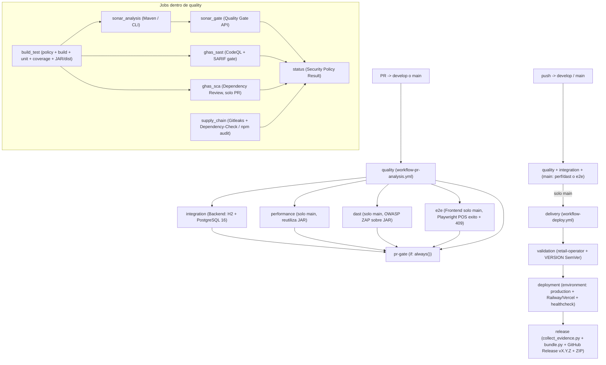

# Arquitectura CI/CD Refactorizada — G4-Retail

## 1. Principios de diseño

1. **Dos workflows por repositorio de aplicación** (`workflow-pr.yml` para PRs y `workflow-main.yml` para `push` a `develop`/`main` y `workflow_dispatch`), eliminando wrappers redundantes (`workflow-evidence.yml`, `workflow-ci.yml`, `workflow-supply-chain.yml`, `workflow-performance.yml`, `workflow-dast.yml`, `workflow-e2e.yml`).
2. **Compilación única por ejecución**: `build_test` compila, ejecuta pruebas unitarias con cobertura (JaCoCo / Vitest LCOV) y empaqueta el artefacto (`retail-*.jar` o `dist/`) una sola vez. `sonar_analysis`, `performance` y `dast` descargan y reutilizan ese mismo artefacto del run.
3. **Validación progresiva `develop` → `main`**: `main` conserva todos los controles base de `develop` y añade `performance` + `dast` (backend) y `e2e` (frontend), sin `continue-on-error` ni aprobaciones falsas por jobs omitidos.
4. **Gate único estable (`pr-gate`)**: evalúa `needs` con `if: always()` y rechaza cualquier control obligatorio que termine en `failure`, `cancelled` o `skipped`.

## 2. Diagrama de arquitectura

## 3. Política progresiva `develop` vs `main`

| Control | PR `feat/*` → `develop` | PR `develop` → `main` | `push` `develop` | `push` `main` |
|---|---|---|---|---|
| Build + Unit + Coverage | Obligatorio | Obligatorio | Obligatorio | Obligatorio |
| Sonar SAST + Quality Gate | Obligatorio | Obligatorio | Obligatorio | Obligatorio |
| CodeQL SAST (SARIF high/critical) | Obligatorio | Obligatorio | Obligatorio | Obligatorio |
| Dependency Review (diff PR) | Obligatorio | Obligatorio | N/A (solo PR) | N/A (solo PR) |
| Gitleaks + SCA completo (Dep-Check / npm audit) | Obligatorio | Obligatorio | Obligatorio | Obligatorio |
| Integración H2 + PostgreSQL 16 (Backend) | Obligatorio | Obligatorio | Obligatorio | Obligatorio |
| Performance POS (reutilizando JAR) | Omitido (permitido) | Obligatorio | Omitido | Obligatorio |
| DAST OWASP ZAP API Scan (reutilizando JAR) | Omitido (permitido) | Obligatorio | Omitido | Obligatorio |
| E2E POS Playwright éxito + 409 (Frontend) | Omitido (permitido) | Obligatorio | Omitido | Obligatorio |
| `pr-gate` | Obligatorio | Obligatorio | N/A | N/A |
| Deploy `production` + Smoke + Release `vX.Y.Z` + ZIP | No ejecuta | No ejecuta | No ejecuta | Obligatorio |

