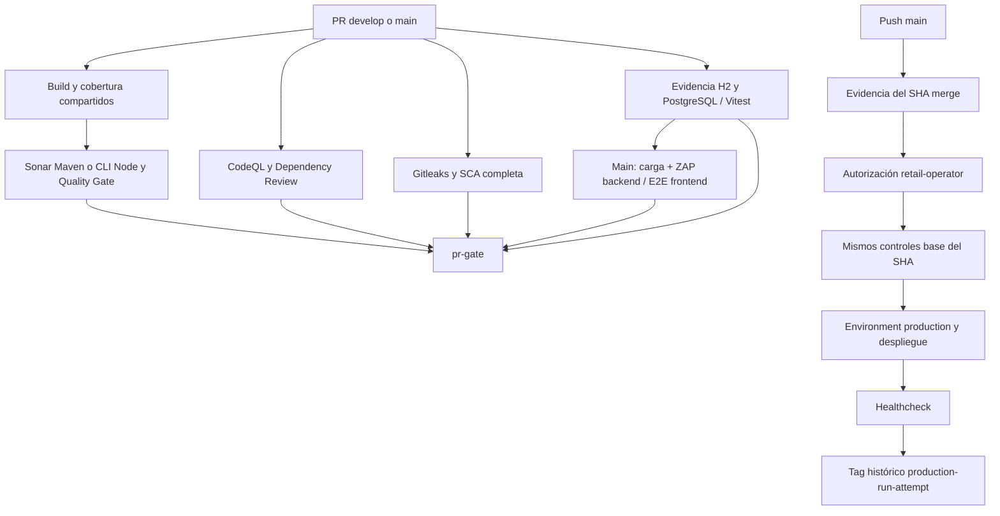

# Implementación DevSecOps V2 — 26/11/2026

## Diagnóstico y alcance

Se reanudó después del pull del usuario. Base: backend `51bc3fa`, frontend `87a2bc9`,
specs `ae9f2e9`, templates `2d44547`, actions `12fc65d`. Auditoría en
[audit-current-state.md](audit-current-state.md). Se conservó el SHA fijado de ZAP,
la autorización retail-operator, rollback, suites e informe de Guillermo. `mvnw.cmd`
tenía una diferencia previa de finales de línea y no forma parte de la implementación.

**Estado global: NO-GO para certificar release.** Hay cambios locales verificados en
herramientas, pero no ejecución remota completa ni prueba de identidad del despliegue.
No se publicaron releases, tags ni despliegues durante esta sesión.

## Arquitectura implementada

| Repo / workflow | Evento | Función |
|---|---|---|
| backend/frontend `workflow-pr.yml` | PR develop/main | evidence + quality → pr-gate obligatorio |
| backend `workflow-evidence.yml` | reusable/manual | H2/PostgreSQL → carga y ZAP para main/manual → evidence-gate |
| backend `workflow-performance.yml` | reusable/manual | Descarga JAR del mismo run; compila solo si no recibe artefacto |
| backend `workflow-dast.yml` | reusable/manual | API Scan activo, preflight, resumen que falla sin JSON válido |
| frontend `workflow-evidence.yml` | reusable/manual | Vitest/build → E2E main/manual → evidence-gate |
| frontend `workflow-e2e.yml` | reusable/manual | Chromium, venta confirmada y rechazo 409, API interceptada |
| templates `workflow-pr-analysis.yml` | reusable | Build/cobertura, Sonar, CodeQL, Dependency Review, supply_chain y status |
| templates `workflow-supply-chain.yml` | reusable | Gitleaks y SCA completa Maven/npm, resumen y artefactos |
| templates `workflow-ci.yml` | reusable producción | Verifica SHA exacto y llama al mismo conjunto de seguridad |
| templates `workflow-deploy.yml` | reusable | Autorización → calidad → production → health → tag histórico |



La rama develop conserva build/cobertura, SAST, SCA, secretos e integración; main añade
carga/DAST y E2E según componente. Un job requerido skipped/cancelled/failure bloquea.
Los trabajos extendidos omitidos en PR develop son explícitamente no aplicables.
No se configuró merge queue: requiere comprobar que está habilitada antes de añadir
`merge_group` y su política de comparación de dependencias.

## Cambios concretos y responsabilidad conservada

- `github-actions/analysis-validator/policy.cjs`: seguridad obligatoria en ambas ramas.
- `github-actions/security-report/pr.cjs`: build ausente y supply_chain incompleta bloquean.
  Tests actualizados y casos negativos añadidos; autorización de despliegue intacta.
- Templates PR: se quitaron `continue-on-error`; Sonar Java usa Maven 5.5.0.6356,
  espera gate y conserva compute-task. Build genera cobertura una vez; Sonar descarga
  clases/LCOV/JaCoCo del mismo run. CodeQL conserva extracción Java independiente.
- Templates CI: desaparece el duplicado reducido de controles; su responsabilidad pasa
  al reusable común de seguridad, también en push/main y dispatch.
- Supply chain: Gitleaks v8.24.2 fijado por digest, salida redactada; Dependency-Check
  Maven 13.0.0 bloquea CVSS >=7 y errores; npm audit del lockfile bloquea high/critical.
  Dependency Review sigue comparando cambios; no se presenta como inventario completo.
- Auditoría npm retirada del workflow frontend evidence: responsabilidad trasladada
  al reusable supply-chain. La ejecución manual de solo evidence no certifica SCA.
- Backend evidence comparte el JAR con performance y ZAP. Los gates locales agregan
  resultados obligatorios. Los workflows PR mantienen sus nombres e IDs anteriores.
- DAST conserva la acción fijada por el pull. Se configura Java 21, JWT de prueba 30 min,
  errores de resumen propagados y rechazo de JSON sin sitios. URLs G5/G7/JWKS apuntan
  a loopback cerrado en carga/DAST para impedir salidas accidentales a los módulos.
- E2E `e2e/venta.cjs`: navegador real con fixtures sintéticos; éxito exige boleta y total,
  rechazo exige mensaje 409 y ausencia de comprobante; una solicitud de venta por caso.
  Capturas de fallos y trazas, JSON con SHA/run. No acredita sistema G4↔G5 real.
- Deploy: checkout del SHA autorizado; tag histórico movido después del healthcheck;
  environment `production`. Se conserva rollback con tags históricos.
- `scripts/release/bundle.py`, `publish.py` y tests en templates: utilidades de paquete
  y publicación con SemVer, checksums, rechazo de colisiones y verificación del run.
  Ver su README para contrato de entrada y límites.

## Releases: decisión y límites actuales

ADR: se eligen releases **independientes por componente**, porque no se acreditó
orquestación ni credenciales multi-repo. Un manifiesto de producto debe fijar ambas
parejas repo/SHA/version/deploy-ID; versiones iguales no significan entrega atómica.
Los tags locales inventariados son `production-*`, no SemVer. No se asignó arbitrariamente
una nueva versión pública ni se sobrescribieron tags.

**La publicación automática SemVer todavía no está conectada al deploy.** Las utilidades
locales no sustituyen el colector de evidencia ni la comprobación de proveedor pendientes.
El backend usa Railway y el frontend Vercel; un HTTP 200 de health no identifica commit.
Railway puede reconstruir fuente y Vercel produce `.vercel/output`: no se afirma que el
JAR/dist de CI sea el binario desplegado. Hace falta consultar y conservar deployment-ID,
SHA del proveedor y, si procede, digest real antes de invocar el publicador.

El ZIP implementado contiene únicamente reportes declarados, manifiesto y SHA256SUMS;
valida rutas, formatos, identidad SHA/run/attempt/repositorio, categorías obligatorias,
GO y smoke, y lo reabre para verificar integridad. Nunca agrega archivos ficticios para
rellenar carpetas. El publicador contrasta el run de producción por API y rechaza tags
existentes; es idempotencia mediante rechazo seguro, no reparación automática.
El filtro de secretos es una defensa adicional, no un detector universal de PII:
revisar privacidad antes de publicación pública. No adjuntar dumps ni reportes reales
con datos de clientes. Los fixtures unitarios no son evidencia de una release real.

## Validación efectuada

| Verificación | Estado |
|---|---|
| Acciones compartidas: 46 pruebas | PASS, `verificacion/acciones.tap` |
| Generador de carga y resumen DAST: 12 pruebas | PASS, `verificacion/herramientas-backend.tap` |
| Bundle/publicación: 9 pruebas | PASS, `verificacion/release-tests.txt` |
| 13 YAML + DAG; 8 escenarios del código real de pr-gate | PASS, `verificacion/yaml-gates.txt` |
| 58 scripts/snippets Bash, `bash -n` | PASS |
| Sintaxis Node E2E | PASS; no significa navegador ejecutado |
| actionlint | PENDIENTE: no está instalado |
| Maven aplicación | BLOQUEADO: wrapper/caché sin permisos de escritura; sin afirmar tests aprobados |
| npm ci offline | BLOQUEADO: fake-indexeddb 6.0.1 no está en caché; Node local 22.17 inferior a algunos engines |
| Navegador E2E, ZAP, carga real | NO EJECUTADO: dependencias/servicios locales no disponibles |
| Sonar/CodeQL/SCA/Gitleaks reales | NO EJECUTADO en esta sesión; herramientas requieren red/CI |
| Publicación GitHub y proveedor | NO EJECUTADO; no hay acceso operativo verificado |

Comandos reproducibles desde raíz:

```powershell
node --test github-actions/tests/*.test.cjs
node --test G4-Retail-backend/scripts/performance/*.test.mjs G4-Retail-backend/scripts/dast/*.test.mjs
python -B -m unittest discover -s devsecops-templates/scripts/release -p test_*.py -v
python -B devsecops-templates/scripts/validate-workspace.py
```

## Operación y migración pendiente

1. Revisar/publicar primero acciones compartidas, luego templates y finalmente callers.
   Siguen referencias @main: fijar los SHA publicados y probados antes de certificar producción.
2. Configurar required check `pr-gate` después de ver su nombre exacto en un run. Conservar
   checks previos durante transición. Rulesets remotos no se modificaron.
3. Revisar environment `production`, reviewers/ramas según plan. Verificar autodeploy
   Railway/Vercel para que Git integration no despliegue por fuera de los gates.
4. Sonar: proyecto → Administration → Analysis Method → Automatic Analysis OFF;
   reejecutar. El último log aportado superó 403 y falló por conflicto de métodos.
   Si el plan solo admite main, resolver compatibilidad de PR; no falsificar gate de develop.
5. Dependency-Check sin API key puede tardar o alcanzar límites NVD; la política actual
   falla ante indisponibilidad. Configurar caché/feed o clave NVD por secret antes de
   exigir disponibilidad continua. Nunca convertir caída de servicio en cero hallazgos.
6. Nombres existentes de configuración: SONAR_TOKEN, SONAR_HOST_URL, GH_TOKEN_G4,
   RAILWAY_TOKEN, RAILWAY_SERVICE, VERCEL_TOKEN, VERCEL_ORG_ID, VERCEL_PROJECT_ID,
   PRODUCTION_HEALTHCHECK_URL. No se modificaron sus valores.
7. Ejecutar CI del SHA combinado, descargar artefactos y revisar nuevos hallazgos.
   Las pruebas de Guillermo siguen vinculadas a sus SHA, no a este refactor.
8. Completar identidad de proveedor, colector normalizado y publicación SemVer automática.
   Sin eso el requisito «cada deploy tiene release SemVer con binario exacto» sigue pendiente.

## Guion de demo (solo con resultados reales disponibles)

Mostrar PR develop con gate y reportes; después candidato main con integración/carga/ZAP
o E2E. Abrir un caso RF-14/15 y su evidencia. Explicar PostgreSQL real efímero frente a
G5/G6/G7 simulados. Mostrar p95/errores del generador existente cuando se ejecute.
Abrir NO-GO y un fallo controlado del gate. Solo mostrar release/ZIP de producción si
se completaron los pendientes; el paquete de pruebas sintético no sustituye esa demo.

## Referencias consultadas

- [Scanner Maven oficial](https://docs.sonarsource.com/sonarqube-community-build/analyzing-source-code/scanners/sonarscanner-for-maven).
- [Dependency-Check](https://dependency-check.github.io/DependencyCheck/dependency-check-maven/check-mojo.html).
- [Gitleaks](https://github.com/gitleaks/gitleaks).
- [Playwright: interceptación HTTP](https://playwright.dev/docs/network).
- [GitHub CLI releases](https://cli.github.com/manual/gh_release_create).
