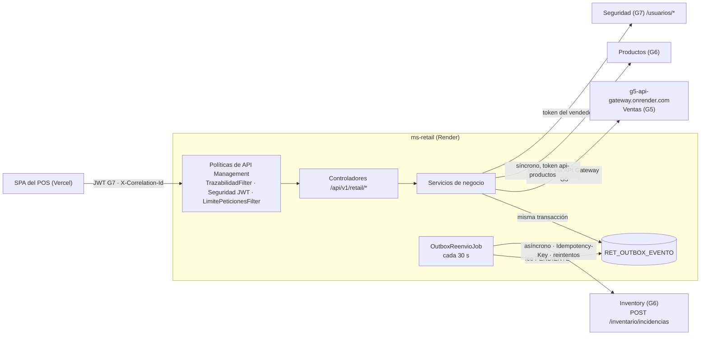
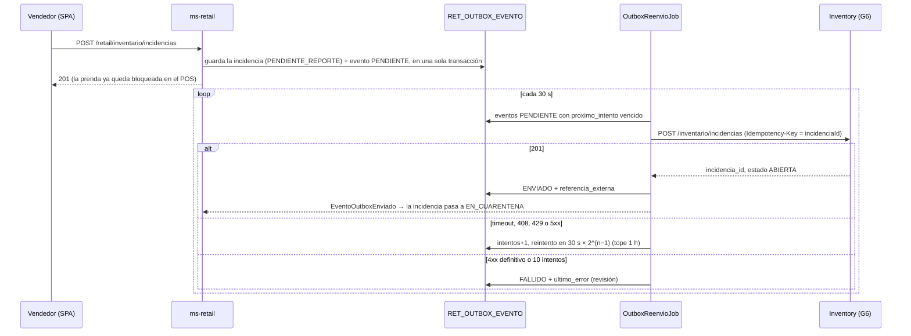

# API Management y mecanismo asíncrono — Módulo Retail (Hito 5)

Criterio de la rúbrica: **Uso de API Management y mecanismo asincrónico entre microservicios (2.5%)**.
Contrato: [`specs/generales/api-contracts.md`](../specs/generales/api-contracts.md) v0.5, §2.8 y §2.9.
Código: `G4-Retail-backend`, paquetes `config.gestionapi`, `service.outbox` e `integracion.inventario`.

---

## 1. Vista general



---

## 2. API Management (§2.8)

Retail aplica la capa en los dos sentidos:

- **Lo que expone:** políticas dentro de `ms-retail`, como filtros que se ejecutan antes de los controladores.
- **Lo que consume:** a Ventas lo consume a través del API Gateway de G5.

| Política | Implementación | Configuración |
|---|---|---|
| Enrutamiento y versionado | Prefijo único `/api/v1/retail/*`; cada respuesta lleva `X-Api-Version: v1` | — |
| Autenticación | JWT de Seguridad (G7) validado con su JWKS (`SeguridadConfig`) | `RETAIL_SEGURIDAD_JWKS_URI` |
| Límite de peticiones | Ventana por minuto por vendedor (`sub`) o por IP (`LimitePeticionesFilter`). Responde `X-RateLimit-Limit`, `X-RateLimit-Remaining` y `429 DEMASIADAS_SOLICITUDES` con `Retry-After` | `RETAIL_LIMITE_PETICIONES_POR_MINUTO` (120 en la nube) |
| Trazabilidad | `X-Correlation-Id` recibido o generado, devuelto en la respuesta y en el cuerpo de los errores, escrito en el MDC y propagado a G5, G6 y G7 (`TrazabilidadFilter`, `CorrelacionSaliente`) | — |
| Catálogo de la API | OpenAPI en `/v3/api-docs` y Swagger UI en `/swagger-ui.html` | — |
| Consumo de Ventas por gateway | `RETAIL_VENTAS_URL=https://g5-api-gateway.onrender.com`. El gateway de G5 aplica autenticación (`401 TOKEN_INVALIDO` sin token), límite (300 por minuto por cliente con token; 60 por IP sin token) y su propio `x-correlation-id` | `RETAIL_VENTAS_URL` |
| Consumo de Productos por gateway | `RETAIL_PRODUCTOS_URL=https://api-gateway.calmgrass-aec0b33c.chilecentral.azurecontainerapps.io/api/v1`. El gateway de G6 responde `401 TOKEN_INVALIDO` sin token y devuelve su `x-correlation-id` (verificado el 26/11) | `RETAIL_PRODUCTOS_URL` |

### Evidencia (backend local, límite forzado a 5 por minuto)

Se ejecutó `RETAIL_LIMITE_PETICIONES_POR_MINUTO=5 ./mvnw spring-boot:run` el 26/11/2026.

```text
$ curl -i http://localhost:8091/api/v1/retail/health
HTTP/1.1 200
X-Correlation-Id: 8130082d-3292-44ac-92f8-63f345895f17
X-Api-Version: v1

$ curl -i -H "X-Correlation-Id: demo-hito5-001" http://localhost:8091/api/v1/retail/control/resumen   (sin token)
HTTP/1.1 401
X-Correlation-Id: demo-hito5-001
{"type":"https://retail.g4/problemas/token-invalido","title":"No autenticado","status":401,
 "code":"TOKEN_INVALIDO","correlationId":"demo-hito5-001", ...}

$ curl -i -H "Authorization: Bearer <jwt vendedor>" .../control/resumen     # peticiones 1 a 5
HTTP/1.1 200
X-RateLimit-Limit: 5
X-RateLimit-Remaining: 4 … 0
{"pickupPendientes":4,"stockCritico":8,"campanasVigentes":3,"fuentesNoDisponibles":[], ...}

$ curl -i -H "Authorization: Bearer <jwt vendedor>" .../control/resumen     # petición 6
HTTP/1.1 429
X-RateLimit-Limit: 5
X-RateLimit-Remaining: 0
Retry-After: 36
{"type":"https://retail.g4/problemas/demasiadas-solicitudes","title":"Demasiadas solicitudes","status":429,
 "detail":"Se superó el límite de 5 peticiones por minuto. Reintente en 36 s","code":"DEMASIADAS_SOLICITUDES", ...}
```

Pruebas automatizadas: `GestionApiIntegrationTest`, `LimitadorPeticionesTest` y `CorrelacionSalienteTest`.

---

## 3. Mecanismo asíncrono: outbox transaccional (§2.9)

**Flujo real:** el reporte de incidencias de F12 a Inventory de G6, `POST /api/v1/inventario/incidencias`. La ruta está en el OpenAPI de G6 con `x-allowed-client-ids: modulo-retail`.



| Garantía | Cómo se logra |
|---|---|
| No se pierde una notificación | El evento se guarda en la misma transacción que la incidencia (`Propagation.MANDATORY`) |
| El vendedor no espera a G6 | El envío lo hace el job, fuera de la petición |
| No se duplica en G6 | `Idempotency-Key` igual al `incidenciaId` en cada reintento; registro idempotente por `(tipo, agregado)` |
| No satura a G6 caído | Espera creciente con tope de 1 h y máximo de 10 intentos |
| Trazabilidad entre módulos | Se guarda el `X-Correlation-Id` de la petición de origen y se reenvía |

**Pasar al Inventory real es solo configuración:** `RETAIL_INVENTARIO_MODO=g6` y `RETAIL_INVENTARIO_URL=<base de G6>/api/v1`. Mientras tanto responde el doble en memoria, con la misma firma.

Pruebas automatizadas: `OutboxIncidenciasIntegrationTest` (registro, envío, rollback, transacción obligatoria e idempotencia), `OutboxDespachadorTest` (reintentos, tope, rechazo definitivo y agotamiento), `InventarioIncidenciasHttpTest` (cabeceras, 503 transitorio, 403 definitivo) e `IncidenciaReportadaPayloadTest` (formato de G6).

Consultas de evidencia en Supabase: `G4-Retail-backend/diseño_bd/migracion-s14-outbox.sql`.

---

## 4. Variables de entorno en Render (para Miguel)

| Variable | Valor | Para qué |
|---|---|---|
| `RETAIL_VENTAS_URL` | `https://g5-api-gateway.onrender.com` | Ventas por su API Gateway |
| `RETAIL_LIMITE_PETICIONES_POR_MINUTO` | `120` | Límite por vendedor |
| `RETAIL_OUTBOX_INTERVALO_MS` | `30000` | Frecuencia del job del outbox |
| `RETAIL_INVENTARIO_MODO` / `RETAIL_INVENTARIO_URL` | `memoria` hasta verificar el token de `api-productos`; luego `g6` (la URL ya viene por defecto) | Destino del outbox |
| `RETAIL_PRODUCTOS_URL` + quitar `mock` de `SPRING_PROFILES_ACTIVE` | `https://api-gateway.calmgrass-aec0b33c.chilecentral.azurecontainerapps.io/api/v1`, cuando G7 registre los scopes | Catálogo, precios, disponibilidad, promociones y campañas reales |
| `RETAIL_INVENTARIO_UBICACIONES` | `TIENDA-MIRAFLORES=aea2f0d8-e8c6-b09c-8e7a-b4a3630bc485` (valor por defecto, confirmado por G6) | `location_id` de G6 por tienda |
| `RETAIL_PEDIDOS_BUSQUEDA_DOCUMENTO` | `registro` hasta que G7 asigne `ventas:pedidos:buscar-documento`; luego `g5` | Búsqueda de pedidos por DNI/RUC (RF-16-DOC) |
| `RETAIL_CLIENTES_MODO` | `memoria` hasta que G7 confirme los permisos del `VENDEDOR`; luego `g7` | Clientes en `/usuarios/*` |

Antes de activar el modo real, ejecutar `migracion-s14-outbox.sql` en Supabase.

> **Ojo con las pruebas de performance:** con el token de `modulo-retail`, el gateway de G5 admite 300 peticiones por minuto sumando todas las cajas (G5, 26/11). Una prueba de carga sobre `POST /retail/ventas` contra G5 real que pase de eso recibe `429` del gateway. Si hace falta más, G5 lo sube a pedido.
