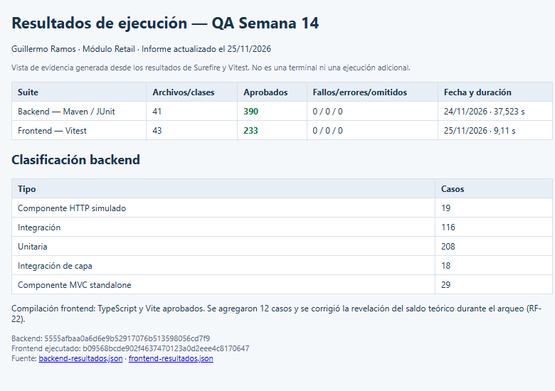
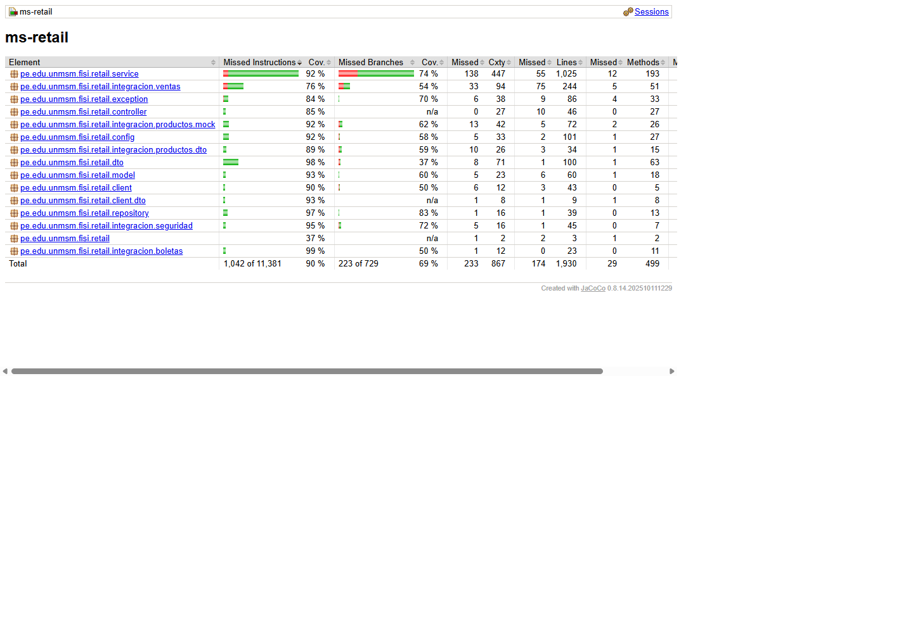
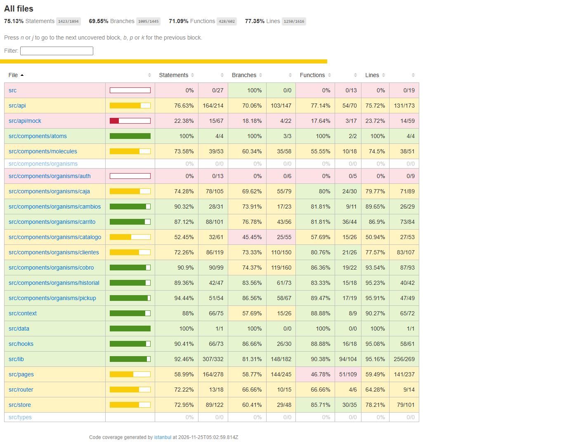

# Informe de Pruebas Unitarias — Semana 14 (Hito 5)

**Responsable:** Guillermo Ramos — QA y Control de Calidad.  
**Revisor:** Miguel — Tech Lead / DevOps.  
**Actualización:** 25/11/2026, America/Lima.  
**Estado:** evidencia técnica local y PR borrador preparadas; pendiente de revisión de Miguel y resolución de SonarCloud. No constituye certificación de producción.

## 1. Resumen ejecutivo

Se revisaron las ocho páginas de la guía de Semana 14 y [AGENTS.md](../../AGENTS.md). Se inventariaron las suites, midió cobertura, construyó la matriz RF-01 a RF-28 y cerraron vacíos prioritarios derivados de las especificaciones. La guía fija entrega a Miguel el 24/11 a las 23:59; este cierre se actualiza el 25/11 y no se presenta como entrega anterior a ese plazo. No se ha enviado comunicación a Miguel.

| Resultado | Backend | Frontend |
|---|---:|---:|
| Archivos/clases principales ejecutados | 41 | 43 |
| Casos aprobados | 390 | 233 |
| Fallos / errores / omitidos | 0 / 0 / 0 | 0 / 0 / 0 |
| Casos nuevos de esta entrega | 2 | 10 |
| Cobertura de líneas, suite completa | 90.98% (1756/1930) | 77.35% (1250/1616) |
| Cobertura de ramas, suite completa | 69.41% (506/729) | 69.55% (1005/1445) |

La cobertura frontend pasó de **68,56% a 77,35% de líneas**, con el mismo alcance de fuentes. Se corrigió un defecto real de **RF-22**: un movimiento durante el arqueo revelaba el saldo teórico antes del conteo. El aviso ahora confirma el registro sin mostrar el saldo; el reporte posterior al cierre conserva la comparación.

Las cifras de backend incluyen pruebas unitarias, de componente y de integración; **no son 390 pruebas unitarias estrictas**. La cobertura tampoco se atribuye exclusivamente a unitarias. No se midió performance, ni se certificaron G5/G6/G7 reales, Supabase o despliegue: esa evidencia corresponde a Miguel.

## 2. Ejecución y reproducción

| Dato | Valor |
|---|---|
| Backend probado | `5555afbaa0a6d6e9b52917076b513598056cd7f9` — rama `test/unitarias-s14` |
| Frontend probado | `b09568bcde902f4637470123a0d2eee4c8170647`; revisión final `5ac85424709d3d0d7b00eb6a46c5db479fb6040a` solo normaliza formato del test de alta |
| Especificaciones base | `1d7d057`; rama del informe `docs/informe-pruebas-unitarias-s14` |
| Entorno | Windows, Node 26.13.0, npm 11.20.0, Temurin JDK 21.0.13.1+2 portátil |
| Backend | Maven Wrapper 3.10.0, Spring Boot 3.5.16, JaCoCo 0.8.14 |
| Frontend | Vitest y @vitest/coverage-v8 5.0.3 |
| Ejecución backend | 24/11/2026, terminó 19:37:16 -05:00; 37,523 s de Maven |
| Ejecución frontend | 25/11/2026, inició 00:02:50 -05:00; 9,11 s de Vitest |
| Compilación frontend | `npm run build` aprobó TypeScript y Vite el 25/11 |

En el backend, configurar JAVA_HOME a un **JDK 21** accesible y ejecutar desde su raíz:

```powershell
.\mvnw.cmd clean test
```

JaCoCo se ejecuta con Maven y genera `target/site/jacoco/index.html` y `jacoco.xml`. Los resultados por caso están en `target/surefire-reports`. Usar `clean` evita mezclar cobertura con corridas anteriores. El JDK portátil usado no modifica Java global y su ubicación temporal puede desaparecer al cerrar la sesión.

En el frontend:

```powershell
npm ci
npm run test:coverage -- --reporter=default --reporter=json --outputFile=coverage/resultados.json
npm run build
```

Se agregó `test:run` como alias de `vitest run` para coincidir con la guía. La cobertura incluye `src/**/*.{ts,tsx}`, también archivos no importados por tests; solo excluye archivos de prueba y declaraciones de tipos. No se fijó un umbral arbitrario ni se excluyeron carpetas de negocio.

### Evidencias verificables

- [Resultados backend por caso](evidencias-s14/backend-resultados.json): extraídos de Surefire, sin propiedades de entorno ni logs completos.
- [Resultados frontend por caso](evidencias-s14/frontend-resultados.json): extracto estructurado del reporter JSON de Vitest.
- [Cobertura backend por paquete](evidencias-s14/backend-cobertura.json) y [frontend por archivo](evidencias-s14/frontend-cobertura.json).
- [Vista de resultados de ejecución](evidencias-s14/resultados-ejecucion.html): presenta los datos exportados; no es una captura de terminal ni una corrida adicional.







Las dos últimas imágenes se capturaron de los reportes HTML reales de las herramientas. JaCoCo muestra porcentajes enteros de instrucciones en su columna principal; la tabla de este informe calcula líneas y ramas desde los contadores XML, por eso los valores visuales no son idénticos.

## 3. Separación de tipos de prueba

| Clasificación backend | Casos |
|---|---:|
| Componente HTTP simulado | 19 |
| Integración | 116 |
| Unitaria | 208 |
| Integración de capa | 18 |
| Componente MVC standalone | 29 |
| **Total** | **390** |

Convención de este informe: unitarias prueban funciones/políticas/servicios aislados; componente HTTP usa MockRestServiceServer; componente MVC standalone ensambla controlador, validadores y manejador sin contexto Spring; integración de capa usa WebMvcTest/DataJpaTest; integración usa SpringBootTest, JDBC real de prueba o servidor JWKS local. Las tres subclases de ClienteValidationTest se separan: validador/servicio son unitarias (64 casos), API es componente (29). El inventario conserva la agrupación principal para no duplicar casos parametrizados o anidados.

El frontend se clasifica por archivo en el inventario: componentes React/DOM, adaptadores simulados y funciones/estado local. Los archivos mixtos se rotulan como tales; no se declara un total unitario estricto a partir de la extensión. Los mocks de HTTP e IndexedDB no prueban servicios remotos ni persistencia al reiniciar un navegador real.

## 4. Cobertura de la suite completa

### Backend por paquete

Prefijo común: `pe.edu.unmsm.fisi.retail`. Porcentaje = cubiertos / (cubiertos + no cubiertos). N/A significa que el contador no tiene elementos, no una prueba aprobada.

| Paquete | Líneas | Ramas | Métodos |
|---|---:|---:|---:|
| (base).model | 90.00% (54/60) | 60.00% (6/10) | 94.44% (17/18) |
| (base).integracion.seguridad | 97.78% (44/45) | 72.22% (13/18) | 100.00% (7/7) |
| (base).repository | 97.44% (38/39) | 83.33% (5/6) | 100.00% (13/13) |
| (base).service | 94.63% (970/1025) | 74.51% (377/506) | 93.78% (181/193) |
| (base).integracion.boletas | 100.00% (23/23) | 50.00% (1/2) | 100.00% (11/11) |
| (base).controller | 78.26% (36/46) | N/A (0/0) | 100.00% (27/27) |
| (base).integracion.productos | N/A (0/0) | N/A (0/0) | N/A (0/0) |
| (base) | 33.33% (1/3) | N/A (0/0) | 50.00% (1/2) |
| (base).dto | 99.00% (99/100) | 37.50% (6/16) | 98.41% (62/63) |
| (base).client.dto | 88.89% (8/9) | N/A (0/0) | 87.50% (7/8) |
| (base).integracion.productos.mock | 93.06% (67/72) | 62.50% (20/32) | 92.31% (24/26) |
| (base).config | 98.02% (99/101) | 58.33% (7/12) | 96.30% (26/27) |
| (base).integracion.productos.dto | 91.18% (31/34) | 59.09% (13/22) | 93.33% (14/15) |
| (base).integracion.ventas | 69.26% (169/244) | 54.32% (44/81) | 90.20% (46/51) |
| (base).client | 93.02% (40/43) | 50.00% (7/14) | 100.00% (5/5) |
| (base).exception | 89.53% (77/86) | 70.00% (7/10) | 87.88% (29/33) |

La primera corrida instrumentada tuvo 91,14% de líneas y 69,68% de ramas; el informe utiliza exclusivamente la corrida final limpia (90,98% y 69,41%). La causa de la variación aún no se ha determinado; no se toma el máximo de varias corridas. Investigar esa variación queda como observación de reproducibilidad.

### Frontend por carpeta

| Carpeta | Líneas | Ramas | Funciones |
|---|---:|---:|---:|
| src | 0.00% (0/19) | N/A (0/0) | 0.00% (0/13) |
| src/api | 75.72% (131/173) | 70.07% (103/147) | 77.14% (54/70) |
| src/api/mock | 23.73% (14/59) | 18.18% (4/22) | 17.65% (3/17) |
| src/components/atoms | 100.00% (4/4) | 100.00% (3/3) | 100.00% (2/2) |
| src/components/molecules | 74.51% (38/51) | 60.34% (35/58) | 55.56% (10/18) |
| src/components/organisms | N/A (0/0) | N/A (0/0) | N/A (0/0) |
| src/components/organisms/auth | 0.00% (0/9) | 0.00% (0/6) | 0.00% (0/5) |
| src/components/organisms/caja | 79.78% (71/89) | 69.62% (55/79) | 80.00% (24/30) |
| src/components/organisms/cambios | 89.66% (26/29) | 73.91% (17/23) | 81.82% (9/11) |
| src/components/organisms/carrito | 86.90% (73/84) | 76.79% (43/56) | 81.82% (36/44) |
| src/components/organisms/catalogo | 50.94% (27/53) | 45.45% (25/55) | 57.69% (15/26) |
| src/components/organisms/clientes | 77.57% (83/107) | 73.33% (110/150) | 80.77% (21/26) |
| src/components/organisms/cobro | 93.55% (87/93) | 74.38% (119/160) | 86.36% (19/22) |
| src/components/organisms/historial | 95.24% (40/42) | 83.56% (61/73) | 83.33% (15/18) |
| src/components/organisms/pickup | 95.92% (47/49) | 86.57% (58/67) | 89.47% (17/19) |
| src/context | 90.28% (65/72) | 57.69% (15/26) | 88.89% (8/9) |
| src/data | 100.00% (1/1) | N/A (0/0) | N/A (0/0) |
| src/hooks | 95.08% (58/61) | 86.67% (26/30) | 88.89% (16/18) |
| src/lib | 95.17% (256/269) | 81.32% (148/182) | 90.38% (94/104) |
| src/pages | 59.49% (141/237) | 58.78% (144/245) | 46.79% (51/109) |
| src/router | 64.29% (9/14) | 66.67% (10/15) | 66.67% (4/6) |
| src/store | 78.22% (79/101) | 60.42% (29/48) | 85.71% (30/35) |
| src/types | N/A (0/0) | N/A (0/0) | N/A (0/0) |

Persisten vacíos en el ensamblaje principal, páginas y catálogo. Un alto porcentaje no sustituye la verificación de cada criterio de negocio. No se declara cobertura funcional del 100%.

## 5. Matriz RF ↔ Test

Todas las suites citadas pasaron en las corridas registradas. La presencia de un test da evidencia del escenario que verifica, no de todos los criterios de un RF. Los nombres enlazan a archivos en revisiones fijas. El JSON permite localizar el caso concreto por nombre. Fuente de requisitos: [matriz maestra](../../FUNCIONALIDADES-RF.md) y [specs](../../specs/).

| RF | Tests backend | Tests frontend | Alcance y criterio pendiente |
|---|---|---|---|
| RF-01 | [AuthControllerTest](https://github.com/Taller-SW-Web/G4-Retail-backend/blob/5555afbaa0a6d6e9b52917076b513598056cd7f9/src/test/java/pe/edu/unmsm/fisi/retail/controller/AuthControllerTest.java), [SeguridadConfigTest](https://github.com/Taller-SW-Web/G4-Retail-backend/blob/5555afbaa0a6d6e9b52917076b513598056cd7f9/src/test/java/pe/edu/unmsm/fisi/retail/config/SeguridadConfigTest.java) | [seguridad.g7](https://github.com/Taller-SW-Web/G4-Retail-frontend/blob/5ac85424709d3d0d7b00eb6a46c5db479fb6040a/src/api/seguridad.g7.test.ts), [seguridad](https://github.com/Taller-SW-Web/G4-Retail-frontend/blob/5ac85424709d3d0d7b00eb6a46c5db479fb6040a/src/api/seguridad.test.ts), [LoginPage](https://github.com/Taller-SW-Web/G4-Retail-frontend/blob/5ac85424709d3d0d7b00eb6a46c5db479fb6040a/src/pages/LoginPage.test.tsx) | Login con transporte simulado; falta prueba UI de bloqueo de doble envío |
| RF-02 | [AuthServiceTest](https://github.com/Taller-SW-Web/G4-Retail-backend/blob/5555afbaa0a6d6e9b52917076b513598056cd7f9/src/test/java/pe/edu/unmsm/fisi/retail/service/AuthServiceTest.java), [AuthControllerTest](https://github.com/Taller-SW-Web/G4-Retail-backend/blob/5555afbaa0a6d6e9b52917076b513598056cd7f9/src/test/java/pe/edu/unmsm/fisi/retail/controller/AuthControllerTest.java) | [ProtectedRoute](https://github.com/Taller-SW-Web/G4-Retail-frontend/blob/5ac85424709d3d0d7b00eb6a46c5db479fb6040a/src/router/ProtectedRoute.test.tsx) | Separar servicio de integración HTTP/RBAC |
| RF-03 | [SeguridadConfigTest](https://github.com/Taller-SW-Web/G4-Retail-backend/blob/5555afbaa0a6d6e9b52917076b513598056cd7f9/src/test/java/pe/edu/unmsm/fisi/retail/config/SeguridadConfigTest.java) | [token](https://github.com/Taller-SW-Web/G4-Retail-frontend/blob/5ac85424709d3d0d7b00eb6a46c5db479fb6040a/src/lib/token.test.ts), [authStore](https://github.com/Taller-SW-Web/G4-Retail-frontend/blob/5ac85424709d3d0d7b00eb6a46c5db479fb6040a/src/store/authStore.test.ts), [ProtectedRoute](https://github.com/Taller-SW-Web/G4-Retail-frontend/blob/5ac85424709d3d0d7b00eb6a46c5db479fb6040a/src/router/ProtectedRoute.test.tsx) | Revisar cabecera Authorization de todos los clientes; no inferirla del login |
| RF-04 | [ProductosMockTest](https://github.com/Taller-SW-Web/G4-Retail-backend/blob/5555afbaa0a6d6e9b52917076b513598056cd7f9/src/test/java/pe/edu/unmsm/fisi/retail/integracion/productos/mock/ProductosMockTest.java), [CatalogoControllerTest](https://github.com/Taller-SW-Web/G4-Retail-backend/blob/5555afbaa0a6d6e9b52917076b513598056cd7f9/src/test/java/pe/edu/unmsm/fisi/retail/controller/CatalogoControllerTest.java) | [catalog](https://github.com/Taller-SW-Web/G4-Retail-frontend/blob/5ac85424709d3d0d7b00eb6a46c5db479fb6040a/src/lib/catalog.test.ts), [scanner](https://github.com/Taller-SW-Web/G4-Retail-frontend/blob/5ac85424709d3d0d7b00eb6a46c5db479fb6040a/src/lib/scanner.test.ts), [useCatalogoTienda](https://github.com/Taller-SW-Web/G4-Retail-frontend/blob/5ac85424709d3d0d7b00eb6a46c5db479fb6040a/src/hooks/useCatalogoTienda.test.tsx), [catalogoApi](https://github.com/Taller-SW-Web/G4-Retail-frontend/blob/5ac85424709d3d0d7b00eb6a46c5db479fb6040a/src/api/catalogoApi.test.ts) | Latencia real queda para performance; no demuestra integración G6 |
| RF-05 | [ProductosMockTest](https://github.com/Taller-SW-Web/G4-Retail-backend/blob/5555afbaa0a6d6e9b52917076b513598056cd7f9/src/test/java/pe/edu/unmsm/fisi/retail/integracion/productos/mock/ProductosMockTest.java), [CatalogoControllerTest](https://github.com/Taller-SW-Web/G4-Retail-backend/blob/5555afbaa0a6d6e9b52917076b513598056cd7f9/src/test/java/pe/edu/unmsm/fisi/retail/controller/CatalogoControllerTest.java) | [catalog](https://github.com/Taller-SW-Web/G4-Retail-frontend/blob/5ac85424709d3d0d7b00eb6a46c5db479fb6040a/src/lib/catalog.test.ts), [ProductDetailModal](https://github.com/Taller-SW-Web/G4-Retail-frontend/blob/5ac85424709d3d0d7b00eb6a46c5db479fb6040a/src/components/organisms/catalogo/ProductDetailModal.test.tsx), [CartPanel](https://github.com/Taller-SW-Web/G4-Retail-frontend/blob/5ac85424709d3d0d7b00eb6a46c5db479fb6040a/src/components/organisms/carrito/CartPanel.test.tsx) | Navegación completa de matriz por teclado/táctil pendiente |
| RF-06 | [CatalogoControllerTest](https://github.com/Taller-SW-Web/G4-Retail-backend/blob/5555afbaa0a6d6e9b52917076b513598056cd7f9/src/test/java/pe/edu/unmsm/fisi/retail/controller/CatalogoControllerTest.java), [ProductosMockTest](https://github.com/Taller-SW-Web/G4-Retail-backend/blob/5555afbaa0a6d6e9b52917076b513598056cd7f9/src/test/java/pe/edu/unmsm/fisi/retail/integracion/productos/mock/ProductosMockTest.java) | [inventory](https://github.com/Taller-SW-Web/G4-Retail-frontend/blob/5ac85424709d3d0d7b00eb6a46c5db479fb6040a/src/lib/inventory.test.ts), [catalogoApi](https://github.com/Taller-SW-Web/G4-Retail-frontend/blob/5ac85424709d3d0d7b00eb6a46c5db479fb6040a/src/api/catalogoApi.test.ts) | Revisar stock desconocido/null con contrato real de G6 |
| RF-07 | [ClienteControllerTest](https://github.com/Taller-SW-Web/G4-Retail-backend/blob/5555afbaa0a6d6e9b52917076b513598056cd7f9/src/test/java/pe/edu/unmsm/fisi/retail/controller/ClienteControllerTest.java), [ClienteValidationTest](https://github.com/Taller-SW-Web/G4-Retail-backend/blob/5555afbaa0a6d6e9b52917076b513598056cd7f9/src/test/java/pe/edu/unmsm/fisi/retail/service/ClienteValidationTest.java) | [CustomerSection](https://github.com/Taller-SW-Web/G4-Retail-frontend/blob/5ac85424709d3d0d7b00eb6a46c5db479fb6040a/src/components/organisms/clientes/CustomerSection.test.tsx) | Falta caso específico Enter y desvinculación; SLA no medido |
| RF-08 | [ClienteControllerTest](https://github.com/Taller-SW-Web/G4-Retail-backend/blob/5555afbaa0a6d6e9b52917076b513598056cd7f9/src/test/java/pe/edu/unmsm/fisi/retail/controller/ClienteControllerTest.java), [ClienteValidationTest](https://github.com/Taller-SW-Web/G4-Retail-backend/blob/5555afbaa0a6d6e9b52917076b513598056cd7f9/src/test/java/pe/edu/unmsm/fisi/retail/service/ClienteValidationTest.java) | [CustomerSection](https://github.com/Taller-SW-Web/G4-Retail-frontend/blob/5ac85424709d3d0d7b00eb6a46c5db479fb6040a/src/components/organisms/clientes/CustomerSection.test.tsx), [AltaRapida.s14](https://github.com/Taller-SW-Web/G4-Retail-frontend/blob/5ac85424709d3d0d7b00eb6a46c5db479fb6040a/src/components/organisms/clientes/AltaRapida.s14.test.tsx) | Registro y cancelación conservan prendas/cantidades; latencia real no medida |
| RF-09 | [ClienteValidationTest](https://github.com/Taller-SW-Web/G4-Retail-backend/blob/5555afbaa0a6d6e9b52917076b513598056cd7f9/src/test/java/pe/edu/unmsm/fisi/retail/service/ClienteValidationTest.java), [ClienteControllerTest](https://github.com/Taller-SW-Web/G4-Retail-backend/blob/5555afbaa0a6d6e9b52917076b513598056cd7f9/src/test/java/pe/edu/unmsm/fisi/retail/controller/ClienteControllerTest.java) | [documento](https://github.com/Taller-SW-Web/G4-Retail-frontend/blob/5ac85424709d3d0d7b00eb6a46c5db479fb6040a/src/lib/documento.test.ts), [CustomerSection](https://github.com/Taller-SW-Web/G4-Retail-frontend/blob/5ac85424709d3d0d7b00eb6a46c5db479fb6040a/src/components/organisms/clientes/CustomerSection.test.tsx), [AltaRapida.s14](https://github.com/Taller-SW-Web/G4-Retail-frontend/blob/5ac85424709d3d0d7b00eb6a46c5db479fb6040a/src/components/organisms/clientes/AltaRapida.s14.test.tsx) | Validación de correo comprobada también en el modal; servicio remoto G7 no validado aquí |
| RF-10 | [CarritoServiceTest](https://github.com/Taller-SW-Web/G4-Retail-backend/blob/5555afbaa0a6d6e9b52917076b513598056cd7f9/src/test/java/pe/edu/unmsm/fisi/retail/service/CarritoServiceTest.java), [CarritoControllerTest](https://github.com/Taller-SW-Web/G4-Retail-backend/blob/5555afbaa0a6d6e9b52917076b513598056cd7f9/src/test/java/pe/edu/unmsm/fisi/retail/controller/CarritoControllerTest.java) | [cart](https://github.com/Taller-SW-Web/G4-Retail-frontend/blob/5ac85424709d3d0d7b00eb6a46c5db479fb6040a/src/lib/cart.test.ts), [cartStorage](https://github.com/Taller-SW-Web/G4-Retail-frontend/blob/5ac85424709d3d0d7b00eb6a46c5db479fb6040a/src/lib/cartStorage.test.ts), [store/cart](https://github.com/Taller-SW-Web/G4-Retail-frontend/blob/5ac85424709d3d0d7b00eb6a46c5db479fb6040a/src/store/cart.test.ts), [CartPanel](https://github.com/Taller-SW-Web/G4-Retail-frontend/blob/5ac85424709d3d0d7b00eb6a46c5db479fb6040a/src/components/organisms/carrito/CartPanel.test.tsx) | Evidencia de helpers no equivale a recarga real del navegador |
| RF-11 | [CarritoServiceTest](https://github.com/Taller-SW-Web/G4-Retail-backend/blob/5555afbaa0a6d6e9b52917076b513598056cd7f9/src/test/java/pe/edu/unmsm/fisi/retail/service/CarritoServiceTest.java) | [lib/cart](https://github.com/Taller-SW-Web/G4-Retail-frontend/blob/5ac85424709d3d0d7b00eb6a46c5db479fb6040a/src/lib/cart.test.ts), [CartPanel](https://github.com/Taller-SW-Web/G4-Retail-frontend/blob/5ac85424709d3d0d7b00eb6a46c5db479fb6040a/src/components/organisms/carrito/CartPanel.test.tsx) | Cupón local cubierto parcialmente; promociones reales G6 pendientes de Mihael |
| RF-12 | [CarritoServiceTest](https://github.com/Taller-SW-Web/G4-Retail-backend/blob/5555afbaa0a6d6e9b52917076b513598056cd7f9/src/test/java/pe/edu/unmsm/fisi/retail/service/CarritoServiceTest.java), [VentaServiceTest](https://github.com/Taller-SW-Web/G4-Retail-backend/blob/5555afbaa0a6d6e9b52917076b513598056cd7f9/src/test/java/pe/edu/unmsm/fisi/retail/service/VentaServiceTest.java) | [lib/cart](https://github.com/Taller-SW-Web/G4-Retail-frontend/blob/5ac85424709d3d0d7b00eb6a46c5db479fb6040a/src/lib/cart.test.ts), [format](https://github.com/Taller-SW-Web/G4-Retail-frontend/blob/5ac85424709d3d0d7b00eb6a46c5db479fb6040a/src/lib/format.test.ts), [CartPanel](https://github.com/Taller-SW-Web/G4-Retail-frontend/blob/5ac85424709d3d0d7b00eb6a46c5db479fb6040a/src/components/organisms/carrito/CartPanel.test.tsx) | Conciliación de varias prendas cubierta; CartPanel ya comprueba cobro bloqueado al pausar y vaciar el mostrador |
| RF-13 | [VentaServiceTest](https://github.com/Taller-SW-Web/G4-Retail-backend/blob/5555afbaa0a6d6e9b52917076b513598056cd7f9/src/test/java/pe/edu/unmsm/fisi/retail/service/VentaServiceTest.java), [CajaCobroServiceTest](https://github.com/Taller-SW-Web/G4-Retail-backend/blob/5555afbaa0a6d6e9b52917076b513598056cd7f9/src/test/java/pe/edu/unmsm/fisi/retail/service/CajaCobroServiceTest.java) | [PaymentModal](https://github.com/Taller-SW-Web/G4-Retail-frontend/blob/5ac85424709d3d0d7b00eb6a46c5db479fb6040a/src/components/organisms/cobro/PaymentModal.test.tsx) | Efectivo insuficiente, tarjeta sin referencia y cambio de medio cubiertos; POS físico fuera de esta suite |
| RF-14 | [VentaServiceTest](https://github.com/Taller-SW-Web/G4-Retail-backend/blob/5555afbaa0a6d6e9b52917076b513598056cd7f9/src/test/java/pe/edu/unmsm/fisi/retail/service/VentaServiceTest.java), [VentaServiceCobroTest](https://github.com/Taller-SW-Web/G4-Retail-backend/blob/5555afbaa0a6d6e9b52917076b513598056cd7f9/src/test/java/pe/edu/unmsm/fisi/retail/service/VentaServiceCobroTest.java), [VentaTiendaCodigoTest](https://github.com/Taller-SW-Web/G4-Retail-backend/blob/5555afbaa0a6d6e9b52917076b513598056cd7f9/src/test/java/pe/edu/unmsm/fisi/retail/service/VentaTiendaCodigoTest.java), [VentaReintentosIntegrationTest](https://github.com/Taller-SW-Web/G4-Retail-backend/blob/5555afbaa0a6d6e9b52917076b513598056cd7f9/src/test/java/pe/edu/unmsm/fisi/retail/service/VentaReintentosIntegrationTest.java) | [ventas](https://github.com/Taller-SW-Web/G4-Retail-frontend/blob/5ac85424709d3d0d7b00eb6a46c5db479fb6040a/src/api/ventas.test.ts), [PaymentModal](https://github.com/Taller-SW-Web/G4-Retail-frontend/blob/5ac85424709d3d0d7b00eb6a46c5db479fb6040a/src/components/organisms/cobro/PaymentModal.test.tsx) | Separar reintento unitario de persistencia/integración |
| RF-15 | [VentaServiceTest](https://github.com/Taller-SW-Web/G4-Retail-backend/blob/5555afbaa0a6d6e9b52917076b513598056cd7f9/src/test/java/pe/edu/unmsm/fisi/retail/service/VentaServiceTest.java), [VentaBoletaCambioTest](https://github.com/Taller-SW-Web/G4-Retail-backend/blob/5555afbaa0a6d6e9b52917076b513598056cd7f9/src/test/java/pe/edu/unmsm/fisi/retail/controller/VentaBoletaCambioTest.java) | [PaymentModal](https://github.com/Taller-SW-Web/G4-Retail-frontend/blob/5ac85424709d3d0d7b00eb6a46c5db479fb6040a/src/components/organisms/cobro/PaymentModal.test.tsx), [Receipt.offline](https://github.com/Taller-SW-Web/G4-Retail-frontend/blob/5ac85424709d3d0d7b00eb6a46c5db479fb6040a/src/components/organisms/cobro/Receipt.offline.test.tsx) | Impresión de comprobante ordinario y ticket regalo requieren casos propios |
| RF-16 | [HistorialPedidosServiceTest](https://github.com/Taller-SW-Web/G4-Retail-backend/blob/5555afbaa0a6d6e9b52917076b513598056cd7f9/src/test/java/pe/edu/unmsm/fisi/retail/service/HistorialPedidosServiceTest.java), [HistorialPedidosControllerTest](https://github.com/Taller-SW-Web/G4-Retail-backend/blob/5555afbaa0a6d6e9b52917076b513598056cd7f9/src/test/java/pe/edu/unmsm/fisi/retail/controller/HistorialPedidosControllerTest.java), [PedidosVentasHttpTest](https://github.com/Taller-SW-Web/G4-Retail-backend/blob/5555afbaa0a6d6e9b52917076b513598056cd7f9/src/test/java/pe/edu/unmsm/fisi/retail/integracion/ventas/PedidosVentasHttpTest.java) | [pedidoApi](https://github.com/Taller-SW-Web/G4-Retail-frontend/blob/5ac85424709d3d0d7b00eb6a46c5db479fb6040a/src/api/pedidoApi.test.ts), [pedidoApi.mocks](https://github.com/Taller-SW-Web/G4-Retail-frontend/blob/5ac85424709d3d0d7b00eb6a46c5db479fb6040a/src/api/pedidoApi.mocks.test.ts), [OrdersHistoryPage](https://github.com/Taller-SW-Web/G4-Retail-frontend/blob/5ac85424709d3d0d7b00eb6a46c5db479fb6040a/src/pages/OrdersHistoryPage.test.tsx) | Consulta histórica por documento sigue limitada por acuerdo G5; no dar RF por cerrado |
| RF-17 | [HistorialPedidosServiceTest](https://github.com/Taller-SW-Web/G4-Retail-backend/blob/5555afbaa0a6d6e9b52917076b513598056cd7f9/src/test/java/pe/edu/unmsm/fisi/retail/service/HistorialPedidosServiceTest.java) | [pedidos](https://github.com/Taller-SW-Web/G4-Retail-frontend/blob/5ac85424709d3d0d7b00eb6a46c5db479fb6040a/src/lib/pedidos.test.ts), [OrderHistoryModal](https://github.com/Taller-SW-Web/G4-Retail-frontend/blob/5ac85424709d3d0d7b00eb6a46c5db479fb6040a/src/components/organisms/historial/OrderHistoryModal.test.tsx), [pedidoApi.mocks](https://github.com/Taller-SW-Web/G4-Retail-frontend/blob/5ac85424709d3d0d7b00eb6a46c5db479fb6040a/src/api/pedidoApi.mocks.test.ts) | Historial con datos simulados; integración real corresponde a Miguel |
| RF-18 | [PickupServiceTest](https://github.com/Taller-SW-Web/G4-Retail-backend/blob/5555afbaa0a6d6e9b52917076b513598056cd7f9/src/test/java/pe/edu/unmsm/fisi/retail/service/PickupServiceTest.java), [PickupControllerTest](https://github.com/Taller-SW-Web/G4-Retail-backend/blob/5555afbaa0a6d6e9b52917076b513598056cd7f9/src/test/java/pe/edu/unmsm/fisi/retail/controller/PickupControllerTest.java), [PickupVentasHttpTest](https://github.com/Taller-SW-Web/G4-Retail-backend/blob/5555afbaa0a6d6e9b52917076b513598056cd7f9/src/test/java/pe/edu/unmsm/fisi/retail/integracion/ventas/PickupVentasHttpTest.java) | [pickupApi](https://github.com/Taller-SW-Web/G4-Retail-frontend/blob/5ac85424709d3d0d7b00eb6a46c5db479fb6040a/src/api/pickupApi.test.ts), [pickupApi.mocks](https://github.com/Taller-SW-Web/G4-Retail-frontend/blob/5ac85424709d3d0d7b00eb6a46c5db479fb6040a/src/api/pickupApi.mocks.test.ts), [PickupPage](https://github.com/Taller-SW-Web/G4-Retail-frontend/blob/5ac85424709d3d0d7b00eb6a46c5db479fb6040a/src/pages/PickupPage.test.tsx) | Latencia real y bandeja remota no demostradas por unitarias |
| RF-19 | [PickupServiceTest](https://github.com/Taller-SW-Web/G4-Retail-backend/blob/5555afbaa0a6d6e9b52917076b513598056cd7f9/src/test/java/pe/edu/unmsm/fisi/retail/service/PickupServiceTest.java), [PickupControllerTest](https://github.com/Taller-SW-Web/G4-Retail-backend/blob/5555afbaa0a6d6e9b52917076b513598056cd7f9/src/test/java/pe/edu/unmsm/fisi/retail/controller/PickupControllerTest.java), [PickupVentasHttpTest](https://github.com/Taller-SW-Web/G4-Retail-backend/blob/5555afbaa0a6d6e9b52917076b513598056cd7f9/src/test/java/pe/edu/unmsm/fisi/retail/integracion/ventas/PickupVentasHttpTest.java) | [DeliveryModal](https://github.com/Taller-SW-Web/G4-Retail-frontend/blob/5ac85424709d3d0d7b00eb6a46c5db479fb6040a/src/components/organisms/pickup/DeliveryModal.test.tsx), [pickupApi.mocks](https://github.com/Taller-SW-Web/G4-Retail-frontend/blob/5ac85424709d3d0d7b00eb6a46c5db479fb6040a/src/api/pickupApi.mocks.test.ts) | Casos titular/tercero presentes; persistencia oficial es integración |
| RF-20 | [CajaServiceTest](https://github.com/Taller-SW-Web/G4-Retail-backend/blob/5555afbaa0a6d6e9b52917076b513598056cd7f9/src/test/java/pe/edu/unmsm/fisi/retail/service/CajaServiceTest.java), [CajaControllerTest](https://github.com/Taller-SW-Web/G4-Retail-backend/blob/5555afbaa0a6d6e9b52917076b513598056cd7f9/src/test/java/pe/edu/unmsm/fisi/retail/controller/CajaControllerTest.java) | [ShiftOpenModal](https://github.com/Taller-SW-Web/G4-Retail-frontend/blob/5ac85424709d3d0d7b00eb6a46c5db479fb6040a/src/components/organisms/caja/ShiftOpenModal.test.tsx) | Fondo negativo, apertura con S/150 y conflicto 409 cubiertos; recorrido completo POS sin turno pendiente de E2E |
| RF-21 | [CajaMovimientoServiceTest](https://github.com/Taller-SW-Web/G4-Retail-backend/blob/5555afbaa0a6d6e9b52917076b513598056cd7f9/src/test/java/pe/edu/unmsm/fisi/retail/service/CajaMovimientoServiceTest.java), [CajaServiceTest](https://github.com/Taller-SW-Web/G4-Retail-backend/blob/5555afbaa0a6d6e9b52917076b513598056cd7f9/src/test/java/pe/edu/unmsm/fisi/retail/service/CajaServiceTest.java), [CajaControllerTest](https://github.com/Taller-SW-Web/G4-Retail-backend/blob/5555afbaa0a6d6e9b52917076b513598056cd7f9/src/test/java/pe/edu/unmsm/fisi/retail/controller/CajaControllerTest.java) | [CashClosePage](https://github.com/Taller-SW-Web/G4-Retail-frontend/blob/5ac85424709d3d0d7b00eb6a46c5db479fb6040a/src/pages/CashClosePage.test.tsx) | Registro exitoso cubierto; rechazo visible por saldo insuficiente pendiente |
| RF-22 | [CajaServiceTest](https://github.com/Taller-SW-Web/G4-Retail-backend/blob/5555afbaa0a6d6e9b52917076b513598056cd7f9/src/test/java/pe/edu/unmsm/fisi/retail/service/CajaServiceTest.java), [CajaCobroServiceTest](https://github.com/Taller-SW-Web/G4-Retail-backend/blob/5555afbaa0a6d6e9b52917076b513598056cd7f9/src/test/java/pe/edu/unmsm/fisi/retail/service/CajaCobroServiceTest.java), [VentaCobroCorteZIntegrationTest](https://github.com/Taller-SW-Web/G4-Retail-backend/blob/5555afbaa0a6d6e9b52917076b513598056cd7f9/src/test/java/pe/edu/unmsm/fisi/retail/service/VentaCobroCorteZIntegrationTest.java) | [CashClosePage](https://github.com/Taller-SW-Web/G4-Retail-frontend/blob/5ac85424709d3d0d7b00eb6a46c5db479fb6040a/src/pages/CashClosePage.test.tsx) | Conteo, cierre en store y reporte cubiertos; fuga de saldo tras movimiento corregida; bloqueo de venta real requiere E2E |
| RF-23 | [PoliticaPlazoCambioTest](https://github.com/Taller-SW-Web/G4-Retail-backend/blob/5555afbaa0a6d6e9b52917076b513598056cd7f9/src/test/java/pe/edu/unmsm/fisi/retail/service/PoliticaPlazoCambioTest.java), [CambioControllerTest](https://github.com/Taller-SW-Web/G4-Retail-backend/blob/5555afbaa0a6d6e9b52917076b513598056cd7f9/src/test/java/pe/edu/unmsm/fisi/retail/controller/CambioControllerTest.java), [RegistroVentaSqlTest](https://github.com/Taller-SW-Web/G4-Retail-backend/blob/5555afbaa0a6d6e9b52917076b513598056cd7f9/src/test/java/pe/edu/unmsm/fisi/retail/repository/RegistroVentaSqlTest.java), [VentaBoletaCambioTest](https://github.com/Taller-SW-Web/G4-Retail-backend/blob/5555afbaa0a6d6e9b52917076b513598056cd7f9/src/test/java/pe/edu/unmsm/fisi/retail/controller/VentaBoletaCambioTest.java) | [ExchangePage](https://github.com/Taller-SW-Web/G4-Retail-frontend/blob/5ac85424709d3d0d7b00eb6a46c5db479fb6040a/src/pages/ExchangePage.test.tsx), [inspeccion](https://github.com/Taller-SW-Web/G4-Retail-frontend/blob/5ac85424709d3d0d7b00eb6a46c5db479fb6040a/src/lib/inspeccion.test.ts) | Persistencia tras reinicio debe atribuirse a integración |
| RF-24 | [PoliticaInspeccionPrendaTest](https://github.com/Taller-SW-Web/G4-Retail-backend/blob/5555afbaa0a6d6e9b52917076b513598056cd7f9/src/test/java/pe/edu/unmsm/fisi/retail/service/PoliticaInspeccionPrendaTest.java), [CambioControllerTest](https://github.com/Taller-SW-Web/G4-Retail-backend/blob/5555afbaa0a6d6e9b52917076b513598056cd7f9/src/test/java/pe/edu/unmsm/fisi/retail/controller/CambioControllerTest.java) | [inspeccion](https://github.com/Taller-SW-Web/G4-Retail-frontend/blob/5ac85424709d3d0d7b00eb6a46c5db479fb6040a/src/lib/inspeccion.test.ts), [ExchangePage](https://github.com/Taller-SW-Web/G4-Retail-frontend/blob/5ac85424709d3d0d7b00eb6a46c5db479fb6040a/src/pages/ExchangePage.test.tsx) | Verificar diferencia de tratamiento de falla de fábrica entre capas |
| RF-25 | [CambioControllerTest](https://github.com/Taller-SW-Web/G4-Retail-backend/blob/5555afbaa0a6d6e9b52917076b513598056cd7f9/src/test/java/pe/edu/unmsm/fisi/retail/controller/CambioControllerTest.java) | [ExchangePage](https://github.com/Taller-SW-Web/G4-Retail-frontend/blob/5ac85424709d3d0d7b00eb6a46c5db479fb6040a/src/pages/ExchangePage.test.tsx) | Emisión cubierta por componentes/integración; canje nuevo corresponde a Cristhian |
| RF-26 | [SaludControllerTest](https://github.com/Taller-SW-Web/G4-Retail-backend/blob/5555afbaa0a6d6e9b52917076b513598056cd7f9/src/test/java/pe/edu/unmsm/fisi/retail/controller/SaludControllerTest.java) | [OfflineBanner](https://github.com/Taller-SW-Web/G4-Retail-frontend/blob/5ac85424709d3d0d7b00eb6a46c5db479fb6040a/src/components/molecules/OfflineBanner.test.tsx), [PaymentModal.offline](https://github.com/Taller-SW-Web/G4-Retail-frontend/blob/5ac85424709d3d0d7b00eb6a46c5db479fb6040a/src/components/organisms/cobro/PaymentModal.offline.test.tsx), [useCatalogoTienda](https://github.com/Taller-SW-Web/G4-Retail-frontend/blob/5ac85424709d3d0d7b00eb6a46c5db479fb6040a/src/hooks/useCatalogoTienda.test.tsx) | Spec menciona <2 s; test de heartbeat contempla 3 s: aclarar escenario antes de cambiar regla |
| RF-27 | [HashContingenciaTest](https://github.com/Taller-SW-Web/G4-Retail-backend/blob/5555afbaa0a6d6e9b52917076b513598056cd7f9/src/test/java/pe/edu/unmsm/fisi/retail/service/HashContingenciaTest.java) | [offlineHash](https://github.com/Taller-SW-Web/G4-Retail-frontend/blob/5ac85424709d3d0d7b00eb6a46c5db479fb6040a/src/lib/offlineHash.test.ts), [offlineStorage](https://github.com/Taller-SW-Web/G4-Retail-frontend/blob/5ac85424709d3d0d7b00eb6a46c5db479fb6040a/src/lib/offlineStorage.test.ts), [offlineStorage.indexeddb](https://github.com/Taller-SW-Web/G4-Retail-frontend/blob/5ac85424709d3d0d7b00eb6a46c5db479fb6040a/src/lib/offlineStorage.indexeddb.test.ts), [Receipt.offline](https://github.com/Taller-SW-Web/G4-Retail-frontend/blob/5ac85424709d3d0d7b00eb6a46c5db479fb6040a/src/components/organisms/cobro/Receipt.offline.test.tsx), [PaymentModal.offline](https://github.com/Taller-SW-Web/G4-Retail-frontend/blob/5ac85424709d3d0d7b00eb6a46c5db479fb6040a/src/components/organisms/cobro/PaymentModal.offline.test.tsx) | IndexedDB simulado no prueba reapertura de navegador real |
| RF-28 | [ContingenciaControllerTest](https://github.com/Taller-SW-Web/G4-Retail-backend/blob/5555afbaa0a6d6e9b52917076b513598056cd7f9/src/test/java/pe/edu/unmsm/fisi/retail/controller/ContingenciaControllerTest.java) | [ContingenciaContext](https://github.com/Taller-SW-Web/G4-Retail-frontend/blob/5ac85424709d3d0d7b00eb6a46c5db479fb6040a/src/context/ContingenciaContext.test.tsx), [PaymentModal.offline](https://github.com/Taller-SW-Web/G4-Retail-frontend/blob/5ac85424709d3d0d7b00eb6a46c5db479fb6040a/src/components/organisms/cobro/PaymentModal.offline.test.tsx) | Agregar evidencia de disparo automático al recuperar conexión; idempotencia backend es integración |

**RF completamente sin evidencia localizada entre RF-01 y RF-28: ninguno.** Existen criterios parciales sin test y verificaciones pendientes, indicados en la última columna. RF-29 a RF-34 quedan fuera del alcance de la matriz solicitada; un test incidental de cuarentena no implica F12 terminada. RF-16-DOC y canje de RF-25 no se marcan cerrados por los mocks o la emisión de vales.

## 6. Casos agregados desde las especificaciones

| Spec / criterio de aceptación | Archivo | Casos nuevos | Resultado |
|---|---|---:|---|
| [F4 RF-11/12](../../specs/f04-carrito-mostrador/f04-carrito.md): retirar cupón restaura importes; suma multítem concilia IGV al centavo | [CarritoServiceTest](https://github.com/Taller-SW-Web/G4-Retail-backend/blob/5555afbaa0a6d6e9b52917076b513598056cd7f9/src/test/java/pe/edu/unmsm/fisi/retail/service/CarritoServiceTest.java) | 2 | Aprobados |
| [F3 RF-08/09](../../specs/f03-gestion-clientes/f03-clientes.md): guardar/cancelar conserva carrito; correo inválido bloquea alta | [AltaRapida.s14](https://github.com/Taller-SW-Web/G4-Retail-frontend/blob/5ac85424709d3d0d7b00eb6a46c5db479fb6040a/src/components/organisms/clientes/AltaRapida.s14.test.tsx) | 3 | Aprobados |
| [F8 RF-20](../../specs/f08-caja-turnos/f08-caja-turnos.md): fondo negativo, apertura S/150, conflicto 409 | [ShiftOpenModal](https://github.com/Taller-SW-Web/G4-Retail-frontend/blob/5ac85424709d3d0d7b00eb6a46c5db479fb6040a/src/components/organisms/caja/ShiftOpenModal.test.tsx) | 3 | Aprobados |
| [F5 RF-13](../../specs/f05-orden-cobro/f05-orden-cobro.md): efectivo insuficiente; referencia de tarjeta y limpieza al cambiar medio | [PaymentModal](https://github.com/Taller-SW-Web/G4-Retail-frontend/blob/5ac85424709d3d0d7b00eb6a46c5db479fb6040a/src/components/organisms/cobro/PaymentModal.test.tsx) | 2 | Aprobados |
| [F8 RF-22](../../specs/f08-caja-turnos/f08-caja-turnos.md): conteo/cierre/reporte; no revelar saldo al registrar movimiento | [CashClosePage](https://github.com/Taller-SW-Web/G4-Retail-frontend/blob/5ac85424709d3d0d7b00eb6a46c5db479fb6040a/src/pages/CashClosePage.test.tsx) | 2 | Aprobados tras corrección |

Cada tarea funcional se verificó antes de continuar y quedó en un commit propio. La instrumentación tiene commits separados. No se cambiaron endpoints, contratos, esquema SQL ni reglas de cálculo.

### Defecto QA-S14-01 — saldo revelado durante arqueo

**Severidad:** alta para integridad del control de caja. **Precondición:** turno abierto, pantalla de cierre. **Pasos:** registrar un movimiento válido antes de enviar el conteo. **Resultado previo:** el aviso incluía “Efectivo estimado en gaveta: S/ 185.00”. **Esperado por RF-22:** no revelar saldo teórico antes del envío. La prueba de regresión falló con ese texto visible; después del cambio muestra solo “Movimiento registrado.” y pasa. El saldo y la diferencia se mantienen en el Reporte Z posterior al cierre. Corrección revisable en commit `b09568b`.

## 7. Pendientes y observaciones

| Prioridad | Pendiente | Motivo / responsable sugerido |
|---|---|---|
| Alta | Recorrido E2E: POS bloqueado sin turno y después de cierre | Componentes y store cubiertos; falta ensamblaje real. Coordinar con Miguel y dueño de F8 |
| Alta | Integración real G5/G6/G7, RF-16-DOC, promociones y canje de vale | Dependen del cierre funcional de otros integrantes; no duplicar la evidencia de Miguel |
| Media | RF-07 Enter/desvincular; RF-21 error por fondos insuficientes en UI | Casos adicionales concretos de interacción |
| Media | RF-15 impresión ordinaria/ticket regalo; RF-27 reinicio de navegador | Requieren ampliar UI/E2E y entorno de impresión/almacenamiento |
| Media | RF-26 detección <2 s frente a heartbeat de 3 s | Aclarar con responsable diferencia entre desconexión del navegador y fallo del backend antes de cambiar reglas |
| Media | RF-28 disparo automático al recuperar red | Flujo de sincronización manual/cola e idempotencia cubiertos; completar el disparador |
| Baja | Spec F3 y formato de errores de gobernanza desactualizados | La spec aún menciona frontend pendiente; AGENTS y README describen formatos distintos. Reconciliar con PO/contrato |

Warnings observados: Node sobre localStorage sin --localstorage-file; React sobre imagen con src vacío en ProductDetailModal; Mockito por auto-adjuntar el agente en Java 21. No se ocultaron warnings. Revisar fixtures y configuración en tareas separadas. La primera ejecución frontend falló por falta local de fake-indexeddb y se resolvió con reinstalación desde el lockfile; no era una aserción de negocio fallida.

Fragilidad: hay usos de Instant.now() en seguridad/contingencia y retardos en mocks de autenticación. No se encontró orden explícito @TestMethodOrder/@Order en la búsqueda realizada, pero no se certificó independencia de orden. Casos similares en backend/frontend validan fronteras distintas y no se eliminaron como supuestos duplicados. PaymentModal con reintento fue de los archivos más lentos; revisar temporizadores sin reducir garantías. Los tiempos de la suite no son métricas de carga del POS.

## 8. Inventario backend por capa

Conteos obtenidos de los casos ejecutados de Surefire, incluyendo expansiones parametrizadas y anidadas. “Transversal” indica soporte técnico, no un RF nuevo.

| Clase / capa | Casos aprobados | Tipo | RF relacionados |
|---|---:|---|---|
| [client/VentasClientTest.java](https://github.com/Taller-SW-Web/G4-Retail-backend/blob/5555afbaa0a6d6e9b52917076b513598056cd7f9/src/test/java/pe/edu/unmsm/fisi/retail/client/VentasClientTest.java) | 4 | Componente HTTP simulado | Transversal |
| [config/DocumentacionApiTest.java](https://github.com/Taller-SW-Web/G4-Retail-backend/blob/5555afbaa0a6d6e9b52917076b513598056cd7f9/src/test/java/pe/edu/unmsm/fisi/retail/config/DocumentacionApiTest.java) | 4 | Integración | Transversal |
| [config/PersonalTiendaInitializerTest.java](https://github.com/Taller-SW-Web/G4-Retail-backend/blob/5555afbaa0a6d6e9b52917076b513598056cd7f9/src/test/java/pe/edu/unmsm/fisi/retail/config/PersonalTiendaInitializerTest.java) | 2 | Unitaria | Transversal |
| [config/SeguridadConfigTest.java](https://github.com/Taller-SW-Web/G4-Retail-backend/blob/5555afbaa0a6d6e9b52917076b513598056cd7f9/src/test/java/pe/edu/unmsm/fisi/retail/config/SeguridadConfigTest.java) | 5 | Integración | RF-01, RF-03 |
| [controller/AuthControllerTest.java](https://github.com/Taller-SW-Web/G4-Retail-backend/blob/5555afbaa0a6d6e9b52917076b513598056cd7f9/src/test/java/pe/edu/unmsm/fisi/retail/controller/AuthControllerTest.java) | 6 | Integración | RF-01, RF-02 |
| [controller/CajaControllerTest.java](https://github.com/Taller-SW-Web/G4-Retail-backend/blob/5555afbaa0a6d6e9b52917076b513598056cd7f9/src/test/java/pe/edu/unmsm/fisi/retail/controller/CajaControllerTest.java) | 12 | Integración | RF-20, RF-21 |
| [controller/CambioControllerTest.java](https://github.com/Taller-SW-Web/G4-Retail-backend/blob/5555afbaa0a6d6e9b52917076b513598056cd7f9/src/test/java/pe/edu/unmsm/fisi/retail/controller/CambioControllerTest.java) | 17 | Integración | RF-23, RF-24, RF-25 |
| [controller/CarritoControllerTest.java](https://github.com/Taller-SW-Web/G4-Retail-backend/blob/5555afbaa0a6d6e9b52917076b513598056cd7f9/src/test/java/pe/edu/unmsm/fisi/retail/controller/CarritoControllerTest.java) | 3 | Integración de capa | RF-10 |
| [controller/CatalogoControllerTest.java](https://github.com/Taller-SW-Web/G4-Retail-backend/blob/5555afbaa0a6d6e9b52917076b513598056cd7f9/src/test/java/pe/edu/unmsm/fisi/retail/controller/CatalogoControllerTest.java) | 11 | Integración | RF-04, RF-05, RF-06 |
| [controller/ClienteControllerTest.java](https://github.com/Taller-SW-Web/G4-Retail-backend/blob/5555afbaa0a6d6e9b52917076b513598056cd7f9/src/test/java/pe/edu/unmsm/fisi/retail/controller/ClienteControllerTest.java) | 8 | Integración de capa | RF-07, RF-08, RF-09 |
| [controller/ContingenciaControllerTest.java](https://github.com/Taller-SW-Web/G4-Retail-backend/blob/5555afbaa0a6d6e9b52917076b513598056cd7f9/src/test/java/pe/edu/unmsm/fisi/retail/controller/ContingenciaControllerTest.java) | 6 | Integración | RF-28 |
| [controller/HistorialPedidosControllerTest.java](https://github.com/Taller-SW-Web/G4-Retail-backend/blob/5555afbaa0a6d6e9b52917076b513598056cd7f9/src/test/java/pe/edu/unmsm/fisi/retail/controller/HistorialPedidosControllerTest.java) | 13 | Integración | RF-16 |
| [controller/PickupControllerTest.java](https://github.com/Taller-SW-Web/G4-Retail-backend/blob/5555afbaa0a6d6e9b52917076b513598056cd7f9/src/test/java/pe/edu/unmsm/fisi/retail/controller/PickupControllerTest.java) | 12 | Integración | RF-18, RF-19 |
| [controller/SaludControllerTest.java](https://github.com/Taller-SW-Web/G4-Retail-backend/blob/5555afbaa0a6d6e9b52917076b513598056cd7f9/src/test/java/pe/edu/unmsm/fisi/retail/controller/SaludControllerTest.java) | 1 | Integración | RF-26 |
| [controller/VentaBoletaCambioTest.java](https://github.com/Taller-SW-Web/G4-Retail-backend/blob/5555afbaa0a6d6e9b52917076b513598056cd7f9/src/test/java/pe/edu/unmsm/fisi/retail/controller/VentaBoletaCambioTest.java) | 1 | Integración | RF-15, RF-23 |
| [exception/ManejoDeErroresTest.java](https://github.com/Taller-SW-Web/G4-Retail-backend/blob/5555afbaa0a6d6e9b52917076b513598056cd7f9/src/test/java/pe/edu/unmsm/fisi/retail/exception/ManejoDeErroresTest.java) | 4 | Integración | Transversal |
| [integracion/productos/mock/ProductosMockTest.java](https://github.com/Taller-SW-Web/G4-Retail-backend/blob/5555afbaa0a6d6e9b52917076b513598056cd7f9/src/test/java/pe/edu/unmsm/fisi/retail/integracion/productos/mock/ProductosMockTest.java) | 12 | Unitaria | RF-04, RF-05, RF-06 |
| [integracion/seguridad/TokenServicioG7Test.java](https://github.com/Taller-SW-Web/G4-Retail-backend/blob/5555afbaa0a6d6e9b52917076b513598056cd7f9/src/test/java/pe/edu/unmsm/fisi/retail/integracion/seguridad/TokenServicioG7Test.java) | 5 | Componente HTTP simulado | Transversal |
| [integracion/ventas/PedidosVentasHttpTest.java](https://github.com/Taller-SW-Web/G4-Retail-backend/blob/5555afbaa0a6d6e9b52917076b513598056cd7f9/src/test/java/pe/edu/unmsm/fisi/retail/integracion/ventas/PedidosVentasHttpTest.java) | 4 | Componente HTTP simulado | RF-16 |
| [integracion/ventas/PickupVentasHttpTest.java](https://github.com/Taller-SW-Web/G4-Retail-backend/blob/5555afbaa0a6d6e9b52917076b513598056cd7f9/src/test/java/pe/edu/unmsm/fisi/retail/integracion/ventas/PickupVentasHttpTest.java) | 6 | Componente HTTP simulado | RF-18, RF-19 |
| [integracion/ventas/RegistroPedidosMostradorTest.java](https://github.com/Taller-SW-Web/G4-Retail-backend/blob/5555afbaa0a6d6e9b52917076b513598056cd7f9/src/test/java/pe/edu/unmsm/fisi/retail/integracion/ventas/RegistroPedidosMostradorTest.java) | 2 | Unitaria | Transversal |
| [repository/CobroTurnoRepositoryTest.java](https://github.com/Taller-SW-Web/G4-Retail-backend/blob/5555afbaa0a6d6e9b52917076b513598056cd7f9/src/test/java/pe/edu/unmsm/fisi/retail/repository/CobroTurnoRepositoryTest.java) | 4 | Integración de capa | Transversal |
| [repository/PersonalTiendaRepositoryTest.java](https://github.com/Taller-SW-Web/G4-Retail-backend/blob/5555afbaa0a6d6e9b52917076b513598056cd7f9/src/test/java/pe/edu/unmsm/fisi/retail/repository/PersonalTiendaRepositoryTest.java) | 3 | Integración de capa | Transversal |
| [repository/RegistroVentaSqlTest.java](https://github.com/Taller-SW-Web/G4-Retail-backend/blob/5555afbaa0a6d6e9b52917076b513598056cd7f9/src/test/java/pe/edu/unmsm/fisi/retail/repository/RegistroVentaSqlTest.java) | 1 | Integración | RF-23 |
| [RetailApplicationTests.java](https://github.com/Taller-SW-Web/G4-Retail-backend/blob/5555afbaa0a6d6e9b52917076b513598056cd7f9/src/test/java/pe/edu/unmsm/fisi/retail/RetailApplicationTests.java) | 2 | Integración | Transversal |
| [service/AuthServiceTest.java](https://github.com/Taller-SW-Web/G4-Retail-backend/blob/5555afbaa0a6d6e9b52917076b513598056cd7f9/src/test/java/pe/edu/unmsm/fisi/retail/service/AuthServiceTest.java) | 4 | Unitaria | RF-02 |
| [service/CajaCobroServiceTest.java](https://github.com/Taller-SW-Web/G4-Retail-backend/blob/5555afbaa0a6d6e9b52917076b513598056cd7f9/src/test/java/pe/edu/unmsm/fisi/retail/service/CajaCobroServiceTest.java) | 25 | Unitaria | RF-13, RF-22 |
| [service/CajaMovimientoServiceTest.java](https://github.com/Taller-SW-Web/G4-Retail-backend/blob/5555afbaa0a6d6e9b52917076b513598056cd7f9/src/test/java/pe/edu/unmsm/fisi/retail/service/CajaMovimientoServiceTest.java) | 9 | Unitaria | RF-21 |
| [service/CajaServiceTest.java](https://github.com/Taller-SW-Web/G4-Retail-backend/blob/5555afbaa0a6d6e9b52917076b513598056cd7f9/src/test/java/pe/edu/unmsm/fisi/retail/service/CajaServiceTest.java) | 12 | Unitaria | RF-20, RF-21, RF-22 |
| [service/CarritoServiceTest.java](https://github.com/Taller-SW-Web/G4-Retail-backend/blob/5555afbaa0a6d6e9b52917076b513598056cd7f9/src/test/java/pe/edu/unmsm/fisi/retail/service/CarritoServiceTest.java) | 8 | Unitaria | RF-10, RF-11, RF-12 |
| [service/ClienteValidationTest.java](https://github.com/Taller-SW-Web/G4-Retail-backend/blob/5555afbaa0a6d6e9b52917076b513598056cd7f9/src/test/java/pe/edu/unmsm/fisi/retail/service/ClienteValidationTest.java) | 93 | Componente MVC standalone / Unitaria | RF-07, RF-08, RF-09 |
| [service/HashContingenciaTest.java](https://github.com/Taller-SW-Web/G4-Retail-backend/blob/5555afbaa0a6d6e9b52917076b513598056cd7f9/src/test/java/pe/edu/unmsm/fisi/retail/service/HashContingenciaTest.java) | 2 | Unitaria | RF-27 |
| [service/HistorialPedidosServiceTest.java](https://github.com/Taller-SW-Web/G4-Retail-backend/blob/5555afbaa0a6d6e9b52917076b513598056cd7f9/src/test/java/pe/edu/unmsm/fisi/retail/service/HistorialPedidosServiceTest.java) | 16 | Unitaria | RF-16, RF-17 |
| [service/PickupServiceTest.java](https://github.com/Taller-SW-Web/G4-Retail-backend/blob/5555afbaa0a6d6e9b52917076b513598056cd7f9/src/test/java/pe/edu/unmsm/fisi/retail/service/PickupServiceTest.java) | 5 | Unitaria | RF-18, RF-19 |
| [service/PoliticaInspeccionPrendaTest.java](https://github.com/Taller-SW-Web/G4-Retail-backend/blob/5555afbaa0a6d6e9b52917076b513598056cd7f9/src/test/java/pe/edu/unmsm/fisi/retail/service/PoliticaInspeccionPrendaTest.java) | 10 | Unitaria | RF-24 |
| [service/PoliticaPlazoCambioTest.java](https://github.com/Taller-SW-Web/G4-Retail-backend/blob/5555afbaa0a6d6e9b52917076b513598056cd7f9/src/test/java/pe/edu/unmsm/fisi/retail/service/PoliticaPlazoCambioTest.java) | 7 | Unitaria | RF-23 |
| [service/VentaCobroCorteZIntegrationTest.java](https://github.com/Taller-SW-Web/G4-Retail-backend/blob/5555afbaa0a6d6e9b52917076b513598056cd7f9/src/test/java/pe/edu/unmsm/fisi/retail/service/VentaCobroCorteZIntegrationTest.java) | 5 | Integración | RF-22 |
| [service/VentaReintentosIntegrationTest.java](https://github.com/Taller-SW-Web/G4-Retail-backend/blob/5555afbaa0a6d6e9b52917076b513598056cd7f9/src/test/java/pe/edu/unmsm/fisi/retail/service/VentaReintentosIntegrationTest.java) | 16 | Integración | RF-14 |
| [service/VentaServiceCobroTest.java](https://github.com/Taller-SW-Web/G4-Retail-backend/blob/5555afbaa0a6d6e9b52917076b513598056cd7f9/src/test/java/pe/edu/unmsm/fisi/retail/service/VentaServiceCobroTest.java) | 3 | Unitaria | RF-14 |
| [service/VentaServiceTest.java](https://github.com/Taller-SW-Web/G4-Retail-backend/blob/5555afbaa0a6d6e9b52917076b513598056cd7f9/src/test/java/pe/edu/unmsm/fisi/retail/service/VentaServiceTest.java) | 24 | Unitaria | RF-12, RF-13, RF-14, RF-15 |
| [service/VentaTiendaCodigoTest.java](https://github.com/Taller-SW-Web/G4-Retail-backend/blob/5555afbaa0a6d6e9b52917076b513598056cd7f9/src/test/java/pe/edu/unmsm/fisi/retail/service/VentaTiendaCodigoTest.java) | 3 | Unitaria | RF-14 |

## 9. Inventario frontend por organismo, página y carpeta

| Archivo | Casos aprobados | Tipo | RF relacionados |
|---|---:|---|---|
| [src/api/catalogoApi.test.ts](https://github.com/Taller-SW-Web/G4-Retail-frontend/blob/5ac85424709d3d0d7b00eb6a46c5db479fb6040a/src/api/catalogoApi.test.ts) | 7 | Adaptador/helper con simulación | RF-04, RF-06 |
| [src/api/pedidoApi.mocks.test.ts](https://github.com/Taller-SW-Web/G4-Retail-frontend/blob/5ac85424709d3d0d7b00eb6a46c5db479fb6040a/src/api/pedidoApi.mocks.test.ts) | 6 | Adaptador/helper con simulación | RF-16, RF-17 |
| [src/api/pedidoApi.test.ts](https://github.com/Taller-SW-Web/G4-Retail-frontend/blob/5ac85424709d3d0d7b00eb6a46c5db479fb6040a/src/api/pedidoApi.test.ts) | 3 | Adaptador/helper con simulación | RF-16 |
| [src/api/pickupApi.mocks.test.ts](https://github.com/Taller-SW-Web/G4-Retail-frontend/blob/5ac85424709d3d0d7b00eb6a46c5db479fb6040a/src/api/pickupApi.mocks.test.ts) | 7 | Adaptador/helper con simulación | RF-18, RF-19 |
| [src/api/pickupApi.test.ts](https://github.com/Taller-SW-Web/G4-Retail-frontend/blob/5ac85424709d3d0d7b00eb6a46c5db479fb6040a/src/api/pickupApi.test.ts) | 4 | Adaptador/helper con simulación | RF-18 |
| [src/api/seguridad.g7.test.ts](https://github.com/Taller-SW-Web/G4-Retail-frontend/blob/5ac85424709d3d0d7b00eb6a46c5db479fb6040a/src/api/seguridad.g7.test.ts) | 3 | Adaptador/helper con simulación | RF-01 |
| [src/api/seguridad.test.ts](https://github.com/Taller-SW-Web/G4-Retail-frontend/blob/5ac85424709d3d0d7b00eb6a46c5db479fb6040a/src/api/seguridad.test.ts) | 6 | Adaptador/helper con simulación | RF-01 |
| [src/api/ventas.test.ts](https://github.com/Taller-SW-Web/G4-Retail-frontend/blob/5ac85424709d3d0d7b00eb6a46c5db479fb6040a/src/api/ventas.test.ts) | 3 | Adaptador/helper con simulación | RF-14 |
| [src/components/molecules/OfflineBanner.test.tsx](https://github.com/Taller-SW-Web/G4-Retail-frontend/blob/5ac85424709d3d0d7b00eb6a46c5db479fb6040a/src/components/molecules/OfflineBanner.test.tsx) | 3 | Componente React/DOM | RF-26 |
| [src/components/organisms/caja/ShiftOpenModal.test.tsx](https://github.com/Taller-SW-Web/G4-Retail-frontend/blob/5ac85424709d3d0d7b00eb6a46c5db479fb6040a/src/components/organisms/caja/ShiftOpenModal.test.tsx) | 3 | Componente React/DOM | RF-20 |
| [src/components/organisms/carrito/CartPanel.test.tsx](https://github.com/Taller-SW-Web/G4-Retail-frontend/blob/5ac85424709d3d0d7b00eb6a46c5db479fb6040a/src/components/organisms/carrito/CartPanel.test.tsx) | 4 | Componente React/DOM | RF-05, RF-10, RF-11, RF-12 |
| [src/components/organisms/catalogo/ProductDetailModal.test.tsx](https://github.com/Taller-SW-Web/G4-Retail-frontend/blob/5ac85424709d3d0d7b00eb6a46c5db479fb6040a/src/components/organisms/catalogo/ProductDetailModal.test.tsx) | 1 | Componente React/DOM | RF-05 |
| [src/components/organisms/clientes/AltaRapida.s14.test.tsx](https://github.com/Taller-SW-Web/G4-Retail-frontend/blob/5ac85424709d3d0d7b00eb6a46c5db479fb6040a/src/components/organisms/clientes/AltaRapida.s14.test.tsx) | 3 | Componente React/DOM | RF-08, RF-09 |
| [src/components/organisms/clientes/CustomerSection.test.tsx](https://github.com/Taller-SW-Web/G4-Retail-frontend/blob/5ac85424709d3d0d7b00eb6a46c5db479fb6040a/src/components/organisms/clientes/CustomerSection.test.tsx) | 10 | Componente React/DOM | RF-07, RF-08, RF-09 |
| [src/components/organisms/cobro/PaymentModal.offline.test.tsx](https://github.com/Taller-SW-Web/G4-Retail-frontend/blob/5ac85424709d3d0d7b00eb6a46c5db479fb6040a/src/components/organisms/cobro/PaymentModal.offline.test.tsx) | 3 | Componente React/DOM | RF-26, RF-27, RF-28 |
| [src/components/organisms/cobro/PaymentModal.test.tsx](https://github.com/Taller-SW-Web/G4-Retail-frontend/blob/5ac85424709d3d0d7b00eb6a46c5db479fb6040a/src/components/organisms/cobro/PaymentModal.test.tsx) | 3 | Componente React/DOM | RF-13, RF-14, RF-15 |
| [src/components/organisms/cobro/Receipt.offline.test.tsx](https://github.com/Taller-SW-Web/G4-Retail-frontend/blob/5ac85424709d3d0d7b00eb6a46c5db479fb6040a/src/components/organisms/cobro/Receipt.offline.test.tsx) | 3 | Componente React/DOM | RF-15, RF-27 |
| [src/components/organisms/historial/OrderHistoryModal.test.tsx](https://github.com/Taller-SW-Web/G4-Retail-frontend/blob/5ac85424709d3d0d7b00eb6a46c5db479fb6040a/src/components/organisms/historial/OrderHistoryModal.test.tsx) | 5 | Componente React/DOM | RF-17 |
| [src/components/organisms/pickup/DeliveryModal.test.tsx](https://github.com/Taller-SW-Web/G4-Retail-frontend/blob/5ac85424709d3d0d7b00eb6a46c5db479fb6040a/src/components/organisms/pickup/DeliveryModal.test.tsx) | 8 | Componente React/DOM | RF-19 |
| [src/context/ContingenciaContext.test.tsx](https://github.com/Taller-SW-Web/G4-Retail-frontend/blob/5ac85424709d3d0d7b00eb6a46c5db479fb6040a/src/context/ContingenciaContext.test.tsx) | 4 | Componente React/DOM | RF-28 |
| [src/hooks/useCatalogoTienda.test.tsx](https://github.com/Taller-SW-Web/G4-Retail-frontend/blob/5ac85424709d3d0d7b00eb6a46c5db479fb6040a/src/hooks/useCatalogoTienda.test.tsx) | 6 | Componente React/DOM | RF-04, RF-26 |
| [src/hooks/useEnfoqueInicial.test.tsx](https://github.com/Taller-SW-Web/G4-Retail-frontend/blob/5ac85424709d3d0d7b00eb6a46c5db479fb6040a/src/hooks/useEnfoqueInicial.test.tsx) | 1 | Componente React/DOM | Transversal |
| [src/lib/cart.test.ts](https://github.com/Taller-SW-Web/G4-Retail-frontend/blob/5ac85424709d3d0d7b00eb6a46c5db479fb6040a/src/lib/cart.test.ts) | 5 | Unitaria/helper/estado local | RF-10, RF-11, RF-12 |
| [src/lib/cartStorage.test.ts](https://github.com/Taller-SW-Web/G4-Retail-frontend/blob/5ac85424709d3d0d7b00eb6a46c5db479fb6040a/src/lib/cartStorage.test.ts) | 3 | Unitaria/helper/estado local | RF-10 |
| [src/lib/catalog.test.ts](https://github.com/Taller-SW-Web/G4-Retail-frontend/blob/5ac85424709d3d0d7b00eb6a46c5db479fb6040a/src/lib/catalog.test.ts) | 9 | Unitaria/helper/estado local | RF-04, RF-05 |
| [src/lib/documento.test.ts](https://github.com/Taller-SW-Web/G4-Retail-frontend/blob/5ac85424709d3d0d7b00eb6a46c5db479fb6040a/src/lib/documento.test.ts) | 45 | Unitaria/helper/estado local | RF-09 |
| [src/lib/format.test.ts](https://github.com/Taller-SW-Web/G4-Retail-frontend/blob/5ac85424709d3d0d7b00eb6a46c5db479fb6040a/src/lib/format.test.ts) | 2 | Unitaria/helper/estado local | RF-12 |
| [src/lib/inspeccion.test.ts](https://github.com/Taller-SW-Web/G4-Retail-frontend/blob/5ac85424709d3d0d7b00eb6a46c5db479fb6040a/src/lib/inspeccion.test.ts) | 7 | Unitaria/helper/estado local | RF-23, RF-24 |
| [src/lib/inventory.test.ts](https://github.com/Taller-SW-Web/G4-Retail-frontend/blob/5ac85424709d3d0d7b00eb6a46c5db479fb6040a/src/lib/inventory.test.ts) | 3 | Unitaria/helper/estado local | RF-06 |
| [src/lib/offlineHash.test.ts](https://github.com/Taller-SW-Web/G4-Retail-frontend/blob/5ac85424709d3d0d7b00eb6a46c5db479fb6040a/src/lib/offlineHash.test.ts) | 2 | Unitaria/helper/estado local | RF-27 |
| [src/lib/offlineStorage.indexeddb.test.ts](https://github.com/Taller-SW-Web/G4-Retail-frontend/blob/5ac85424709d3d0d7b00eb6a46c5db479fb6040a/src/lib/offlineStorage.indexeddb.test.ts) | 4 | Componente IndexedDB simulado | RF-27 |
| [src/lib/offlineStorage.test.ts](https://github.com/Taller-SW-Web/G4-Retail-frontend/blob/5ac85424709d3d0d7b00eb6a46c5db479fb6040a/src/lib/offlineStorage.test.ts) | 3 | Unitaria/helper/estado local | RF-27 |
| [src/lib/pedidos.test.ts](https://github.com/Taller-SW-Web/G4-Retail-frontend/blob/5ac85424709d3d0d7b00eb6a46c5db479fb6040a/src/lib/pedidos.test.ts) | 8 | Unitaria/helper/estado local | RF-17 |
| [src/lib/scanner.test.ts](https://github.com/Taller-SW-Web/G4-Retail-frontend/blob/5ac85424709d3d0d7b00eb6a46c5db479fb6040a/src/lib/scanner.test.ts) | 6 | Unitaria/helper/estado local | RF-04 |
| [src/lib/token.test.ts](https://github.com/Taller-SW-Web/G4-Retail-frontend/blob/5ac85424709d3d0d7b00eb6a46c5db479fb6040a/src/lib/token.test.ts) | 5 | Unitaria/helper/estado local | RF-03 |
| [src/pages/CashClosePage.test.tsx](https://github.com/Taller-SW-Web/G4-Retail-frontend/blob/5ac85424709d3d0d7b00eb6a46c5db479fb6040a/src/pages/CashClosePage.test.tsx) | 2 | Componente React/DOM | RF-21, RF-22 |
| [src/pages/ExchangePage.test.tsx](https://github.com/Taller-SW-Web/G4-Retail-frontend/blob/5ac85424709d3d0d7b00eb6a46c5db479fb6040a/src/pages/ExchangePage.test.tsx) | 6 | Componente React/DOM | RF-23, RF-24, RF-25 |
| [src/pages/LoginPage.test.tsx](https://github.com/Taller-SW-Web/G4-Retail-frontend/blob/5ac85424709d3d0d7b00eb6a46c5db479fb6040a/src/pages/LoginPage.test.tsx) | 2 | Componente React/DOM | RF-01 |
| [src/pages/OrdersHistoryPage.test.tsx](https://github.com/Taller-SW-Web/G4-Retail-frontend/blob/5ac85424709d3d0d7b00eb6a46c5db479fb6040a/src/pages/OrdersHistoryPage.test.tsx) | 7 | Componente React/DOM | RF-16 |
| [src/pages/PickupPage.test.tsx](https://github.com/Taller-SW-Web/G4-Retail-frontend/blob/5ac85424709d3d0d7b00eb6a46c5db479fb6040a/src/pages/PickupPage.test.tsx) | 1 | Componente React/DOM | RF-18 |
| [src/router/ProtectedRoute.test.tsx](https://github.com/Taller-SW-Web/G4-Retail-frontend/blob/5ac85424709d3d0d7b00eb6a46c5db479fb6040a/src/router/ProtectedRoute.test.tsx) | 7 | Componente React/DOM | RF-02, RF-03 |
| [src/store/authStore.test.ts](https://github.com/Taller-SW-Web/G4-Retail-frontend/blob/5ac85424709d3d0d7b00eb6a46c5db479fb6040a/src/store/authStore.test.ts) | 4 | Unitaria/helper/estado local | RF-03 |
| [src/store/cart.test.ts](https://github.com/Taller-SW-Web/G4-Retail-frontend/blob/5ac85424709d3d0d7b00eb6a46c5db479fb6040a/src/store/cart.test.ts) | 6 | Unitaria/helper/estado local | RF-10 |

## 10. Revisión y entrega

PR borrador hacia develop: [backend #53](https://github.com/Taller-SW-Web/G4-Retail-backend/pull/53), [frontend #47](https://github.com/Taller-SW-Web/G4-Retail-frontend/pull/47) e [informe #30](https://github.com/Taller-SW-Web/G4-Retail-specs/pull/30). Pendientes de revisión; no se han fusionado.

**Seguimiento de CI (25/11):** las primeras ejecuciones aprobaron Build and Unit Tests, CodeQL y Dependency Review en ambos repositorios. SonarCloud frontend falló al consultar metadatos JRE con HTTP 403 y señaló SONAR_TOKEN; requiere revisión de credenciales por DevOps. El backend falló en el job de Sonar por cargar simultáneamente los agentes JaCoCo 0.8.13 (plantilla CI) y 0.8.14 (POM). El commit `c22a8c8` alinea el POM a 0.8.13. Los porcentajes y capturas locales anteriores corresponden a 0.8.14 y no se atribuyen a una nueva medición con 0.8.13.

- [x] Inventario y ejecución de backend y frontend.
- [x] Separación de unitarias, componentes e integración.
- [x] Cobertura por paquete/carpeta con fuentes no probadas incluidas.
- [x] Matriz RF-01 a RF-28 y pendientes explícitos.
- [x] 12 casos agregados, corrección de RF-22 y verificación local.
- [x] Evidencias estructuradas y capturas de resultados/cobertura.
- [x] Tres PR borrador hacia develop creadas y resultados de CI inspeccionados.
- [ ] Resolver acceso a SonarCloud (HTTP 403 / SONAR_TOKEN) y completar revisión del equipo.
- [ ] Recepción y aprobación de Miguel.

La revisión de Miguel y las verificaciones remotas pendientes impiden afirmar “entregado y aprobado al 100%”. La evidencia local del alcance ejecutado está disponible para revisión.

**Verificación del ajuste JaCoCo:** en la [ejecución CI del backend con c22a8c8](https://github.com/Taller-SW-Web/G4-Retail-backend/actions/runs/45553340039/job/138999485122), Maven registró `Tests run: 390, Failures: 0, Errors: 0, Skipped: 0` y `BUILD SUCCESS`. La doble instrumentación quedó resuelta. El paso posterior de SonarCloud falló con el mismo HTTP 403 sobre metadatos JRE y referencia a SONAR_TOKEN que el frontend. No se desactivó el análisis ni se alteraron credenciales; el responsable de DevOps debe validar el token/permisos y repetir el análisis.
